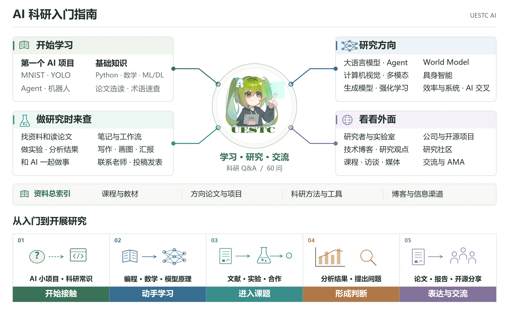

<p align="center"></p>

<h1 align="center">AI Research Guide</h1>
<p align="center">University choices, your first research project, and lessons along the way</p>
<p align="center"><a href="README.md">中文</a> · <b>English</b> · <a href="https://takamatsu-hikaru.github.io/AI-Research-Guide/en/">Read online</a> · <a href="https://wiki.uestcai.top/en/">Club platform edition</a> · <a href="https://takamatsu-hikaru.github.io/blog/guide/en/index.html">Personal website edition</a> · <a href="https://takamatsu-hikaru.github.io/AI-Research-Guide/en/ama.html">Discussions</a></p>

This guide is for students starting university who want to explore AI and research. It brings together our answers to questions about university choices and getting started in research, alongside beginner projects, key papers across research areas, courses, and tools. It also covers contacting faculty, joining a lab for the first time, failed experiments, and the anxiety of comparing yourself with your peers.

[](https://wiki.uestcai.top/en/)

## Start here

| What are you thinking about? | Read |
| --- | --- |
| The choices university offers and where you want to go | [A letter to new university students](content/guide/en/welcome.md) |
| Why try research? How do you begin, find a direction, or contact a supervisor? | [Getting started in research: 60 questions](content/guide/en/research.md) |
| Making a small project work | [Your first AI project: where to begin?](content/guide/en/start.md) |

## Explore the guide

[AI terminology and conferences · 中文](https://takamatsu-hikaru.github.io/AI-Research-Guide/wiki/index.html): search names and abbreviations, browse by field, and follow related concepts.

| Section | Topics |
| --- | --- |
| Foundations and learning | [Which foundations do you need, and how much?](content/guide/en/basics.md) · [Choose a paper to read](content/guide/en/papers.md) |
| Research directions | [What do different AI research areas study?](content/guide/en/directions.md) · [Large language models: understanding, generation, and reasoning](content/guide/en/llm.md) · [Agents: getting models to do things](content/guide/en/agent.md) · [Computer vision: understanding images](content/guide/en/vision.md) · [Multimodal models: connecting images and language](content/guide/en/multimodal.md) · [Generative models: how an image is made](content/guide/en/generation.md) · [Reinforcement learning: actions have consequences](content/guide/en/rl.md) · [World models: predict, then act](content/guide/en/world-model.md) · [Embodied AI: from seeing to acting](content/guide/en/embodied.md) · [Efficiency and systems: making models run](content/guide/en/systems.md) · [Interdisciplinary AI](content/guide/en/ai4x.md) |
| Doing research | [Finding and reading papers](content/guide/en/reading.md) · [Writing, figures, and talks](content/guide/en/writing.md) · [Contacting researchers and collaborating](content/guide/en/contact.md) · [Working with AI](content/guide/en/ai.md) |
| Experience and life | [Experience, practical lessons, and wrong turns](content/guide/en/experience.md) · [Paper reading and note workflows](content/guide/en/irene-workflow.md) · [My Freshman-Year Review: The World Suddenly Opens Wide](content/guide/en/timeline.md) · [Living well](content/guide/en/life.md) |
| Looking outside | [Lookout: what are researchers and labs working on?](content/guide/en/lookout.md) · [Technical blogs and research perspectives](content/guide/en/blogs.md) · [LessWrong: research judgment and AI use](content/guide/en/lesswrong.md) · [Mu Li: from courses to close paper reading](content/guide/en/limu.md) · [Getting to know research groups](content/guide/en/labs.md) |
| Resources | [Resource index](content/guide/en/resources.md) · [Research methods and communication](content/guide/en/research-conversations.md) |

The [website](https://takamatsu-hikaru.github.io/AI-Research-Guide/en/) includes full-text search, expandable research Q&A, and introductions, roadmaps, terminology, and illustrated paper cards across 10 fields. Cards link to the original papers and related projects.

The [AI chronicle and research overview](https://takamatsu-hikaru.github.io/AI-Research-Guide/en/directions.html) connect major research paths. [Lookout](https://takamatsu-hikaru.github.io/AI-Research-Guide/en/lookout.html) collects AI and robotics company research. The Agent section includes Generative Agents in Smallville and Voyager’s Minecraft skill exploration.

## Research communities and knowledge sharing

### OpenEnvision

[OpenEnvision (OE)](https://openenvision.github.io/) is an open AI research community connecting academia and industry, with interests in world models, multimodal intelligence, vision, and embodied AI. It also shares research knowledge through curated writing, interviews, and courses.

- **[BlogrXiv: AI research blogs and technical writing](https://openenvision.github.io/BlogrXiv/site/index.html)** brings together research blogs, lab essays, and technical notes. Browse by field for explanations, engineering experience, and research methods, then follow links to the original articles.
- **[ScholarTube: AI interviews, podcasts, and courses](https://openenvision.github.io/ScholarTube/)** collects long-form researcher interviews, video podcasts, complete courses, and research talks across agents, world models, vision, robotics, and research practice, with links to the original videos.

You can also recommend articles and videos to [BlogrXiv](https://github.com/OpenEnvision/BlogrXiv) and [ScholarTube](https://github.com/OpenEnvision/ScholarTube).

### Lumina

[Lumina](https://lumina-embodied.ai/) brings together embodied AI research, open projects and community events. Its [Embodied AI Guide](https://github.com/TianxingChen/Embodied-AI-Guide) organizes the field’s learning resources; Talks, research coverage and events on the website introduce the people and projects behind the work.

### AgentHub

[AgentHub](https://hqhq1025.github.io/agent_hub/) collects discussions from the Agent community into daily and weekly digests, covering agent research, tools, engineering practice and industry developments. Browse by date, discussion group or external news to see what people are working through, how they compare technical approaches and where their views differ.

## Discuss and contribute

Bring questions about learning, projects, and research to the [discussion board](https://takamatsu-hikaru.github.io/AI-Research-Guide/en/ama.html).

Contributions are welcome on [GitHub](https://github.com/Takamatsu-Hikaru/AI-Research-Guide): open an issue or submit a PR with corrections and resources. If you find the guide useful, give it a star or share it with others.

Articles are in [content/guide/zh](content/guide/zh) and [content/guide/en](content/guide/en). Field introductions and paper cards are in [content/guide/fieldnotes](content/guide/fieldnotes).

## About and acknowledgments

[About the UESTC AI Club guide](content/guide/en/about.md). Club members wrote the opening essays, research Q&A, and personal accounts. Courses, papers, and blogs link to their original authors.

This guide continues the work of the [UESTC AI Club Guide](https://my.feishu.cn/docx/HQYodz7thohS1Nxo6KAcoeNtnbb) and AI4UESTC_Beginners. We thank their authors and contributors. The [Lumina Embodied AI Guide](https://github.com/TianxingChen/Embodied-AI-Guide) informed the organization and resource selection for embodied AI. Figure attribution is recorded in the [figure index](content/guide/paper-figures.json).

[irene](https://github.com/tseirene6) contributed the experience behind [Paper reading and note workflows](content/guide/en/irene-workflow.md): paper and note management, research briefs, reading depth, and questions from AI. Related methods throughout the guide are adapted from this account.

## Update the guide

Edit [English Markdown](content/guide/en) or [Chinese Markdown](content/guide/zh) directly on GitHub. Changes to the main branch automatically generate HTML and publish the website. See the [editing and contribution guide](CONTRIBUTING.md#editing-in-english) for paper cards, company directories and page styling.

## Build locally

Use Node.js 22 or newer.

```bash
npm ci
npm run build          # default edition
npm run build:uestc    # second edition (uestc_ai skin)
npm test               # regression checks across both editions
```

Open `public/blog/guide/zh/index.html` or `public/blog/guide/en/index.html`; the second edition is at `public/blog/guide/guide-uestc/zh/index.html`.


The GitHub Pages and personal website editions share the club guide’s articles, paper cards, and presentation. The personal edition also retains the university letter, personal essays, and LessWrong selections on growth and work–life balance.
