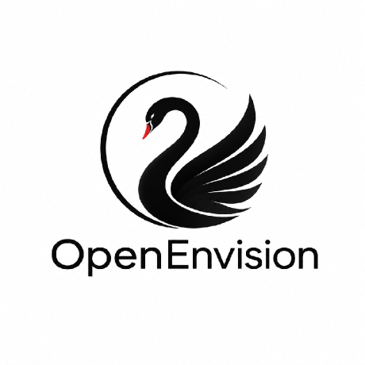

<p align="center"></p>

<h1 align="center">AI 学习与科研指南</h1>
<p align="center">面向全球大学生与初级研究者的开放指南</p>
<p align="center"><b>中文</b> · <a href="README.md">English</a> · <a href="https://github.com/OpenEnvision/ai_research_guide">项目仓库</a></p>

建立 AI 基础，完成可复现项目，逐步将问题转化为他人能够检查的研究。指南连接编程、数学、机器学习、研究方向、文献阅读、实验设计、评测、研究工程与学术交流。中英文版本共享核心学习路线与资源。

## 按当前任务开始

| 目标 | 指南入口 |
| --- | --- |
| 制定系统学习计划 | [学习路线](content/guide/zh/learning-path.md) · [基础知识](content/guide/zh/basics.md) |
| 选择课程与练习 | [课程](content/guide/zh/courses.md) · [实践训练](content/guide/zh/practice.md) |
| 完成第一个项目 | [入门项目](content/guide/zh/start.md) |
| 选择研究问题 | [研究方向地图](content/guide/zh/directions.md) · [进阶专题](content/guide/zh/advanced-topics.md) |
| 阅读、设计与评估研究 | [文献阅读](content/guide/zh/reading.md) · [实验设计](content/guide/zh/research-methods.md) · [数据集](content/guide/zh/datasets.md) |
| 交付可靠的研究材料 | [研究工程](content/guide/zh/engineering.md) · [负责任 AI](content/guide/zh/responsible-ai.md) |
| 表达与合作 | [科研写作](content/guide/zh/writing.md) · [学术联系](content/guide/zh/contact.md) |

[科研入门 60 问](content/guide/zh/research.md)解答各阶段的常见问题，[资源总索引](content/guide/zh/resources.md)提供完整目录。保留署名的[个人经历](content/guide/zh/experience.md)作为补充阅读。

## 本地预览

需要 Node.js 22 或更高版本，以及用于本地服务器的 Python 3。

```bash
npm ci
npm run build
npm run dev
```

打开[英文展示主页](http://127.0.0.1:8000/blog/guide/)或[中文展示主页](http://127.0.0.1:8000/blog/guide/zh.html)。

| 页面 | 生成文件 |
| --- | --- |
| GitHub Pages 的仓库根入口 | `index.html` |
| 本地默认英文展示主页 | `public/blog/guide/index.html` |
| 中文展示主页 | `public/blog/guide/zh.html` |
| 站点根入口，同样展示主页 | `public/index.html` |
| 英文指南概览 | `public/blog/guide/en/index.html` |
| 中文指南概览 | `public/blog/guide/zh/index.html` |

本次修订为**本地预览**。已有公开站点可能仍是旧版，发布需要另行执行。外部链接尚未全部逐项复核；资源页单独记录核验范围与日期。

## 构建不同版本

```bash
npm run build                     # 主站、展示主页及仓库根入口
npm run build:pages               # GitHub Pages 发布包，输出至 dist/github-pages
npm run build:uestc               # 副版本
npm run build:uestc:standalone    # 副版本独立打包
npm test                          # 构建与行为回归检查
```

两版共用 [content/guide/en](content/guide/en) 和 [content/guide/zh](content/guide/zh) 的核心正文。主版本每语言 45 页，包含 3 页社区视角文章。年度回顾（`timeline`）已退出发布范围，Markdown 源稿保留存档；副版本通过 manifest 选取每语言 42 页，不含这三篇社区文章，入口生成于 `public/blog/guide/guide-uestc/en/index.html` 及对应的 `zh/index.html`。`content/guide/uestc` 下原有 Markdown 覆盖文件作为历史来源保留，不再作为分叉的核心正文使用。

## 部署到 GitHub Pages

`npm run build` 会在仓库最外层生成完整的英文主页 `index.html`，同时生成 `.nojekyll`。主页通过相对路径引用 `public/blog/guide/` 下的页面和资源，也适用于带有仓库名的 GitHub Pages 地址。

在仓库 **Settings → Pages → Build and deployment** 中选择一种发布方式：

- **Deploy from a branch：**运行 `npm run build`，提交根目录的 `index.html`、`.nojekyll` 和完整的 `public/blog/guide/` 目录，再选择发布分支及 **/(root)**。之后每次修改源内容，都需要重新构建并提交生成文件。
- **GitHub Actions：**将发布来源设为 **GitHub Actions**。仓库自带的 Pages 工作流会执行 `npm run build:pages`，发布 `dist/github-pages/`。这个发布包包含主版本的根目录 `index.html`、`.nojekyll` 和 `public/blog/guide/`。

上传或复制时请保留完整目录结构，单独上传 `index.html` 无法组成完整网站。本次本地修改尚未发布到远程仓库。仓库设置步骤可参阅 GitHub 的[发布来源说明](https://docs.github.com/en/pages/getting-started-with-github-pages/configuring-a-publishing-source-for-your-github-pages-site)。

## 来源与贡献

项目由 [OpenEnvision](https://openenvision.org/) 维护，基于 [Takamatsu-Hikaru/AI-Research-Guide](https://github.com/Takamatsu-Hikaru/AI-Research-Guide)、早期[学生共同编写的 AI 学习材料](https://my.feishu.cn/docx/HQYodz7thohS1Nxo6KAcoeNtnbb) 继续整理。原始文章与改编内容保留作者署名和来源链接。[Lumina 具身智能指南](https://github.com/TianxingChen/Embodied-AI-Guide)为具身资源选取提供参考；[irene](https://github.com/tseirene6) 提供了[论文阅读与笔记工作流](content/guide/zh/irene-workflow.md)的实践来源。

编辑标准与完整致谢见[关于本指南](content/guide/zh/about.md)，修改方式见 [CONTRIBUTING.md](CONTRIBUTING.md)。更正请说明具体页面、原始依据及对应语言的调整。方向材料位于 [content/guide/fieldnotes](content/guide/fieldnotes)，插图来源记录在 [paper-figures.json](content/guide/paper-figures.json)。
