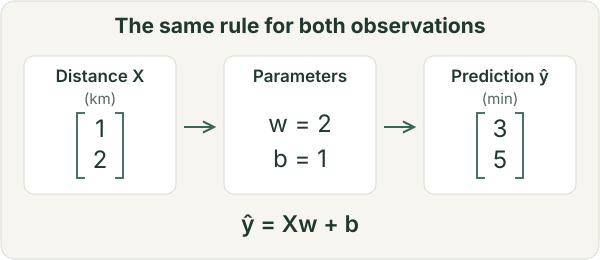
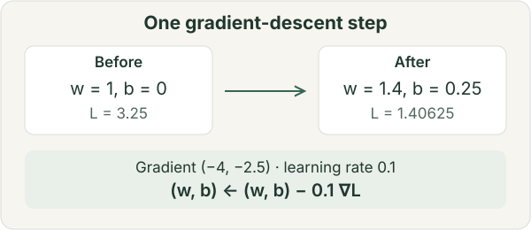

# Foundations: how the ideas fit together

Foundational ideas are easier to understand when you can connect programming, mathematics, and evaluation through a single problem. This chapter follows a small numerical prediction example. Read it in order for a first introduction, or use the section links to revisit a missing concept.

Begin with [functions and arrays](#basics-arrays), then [linear models](#basics-linear-algebra) and [derivatives](#basics-calculus). Study [probability](#basics-probability) alongside this sequence: finite probability examples need arithmetic, not a completed calculus course. Bring the ideas together in [learning](#basics-learning) and [evaluation](#basics-evaluation). You can learn more advanced mathematics as your questions require it; you do not need to master it all before starting a first project.

## From observations to arrays

Suppose we want to predict travel time from distance. For this worked example, we will use two **invented observations**: `(1 km, 3 min)` and `(2 km, 5 min)`. Distance is the **feature** available at prediction time; travel time is the **target** we want to predict. One journey is one observation. Real journeys also depend on traffic, route, and other factors.

A numerical array stores values with a shape. With `n` journeys and `d` features, use an input matrix `X` of shape `(n, d)` and a target vector `y` of shape `(n,)`. Here `X = [[1], [2]]` has shape `(2, 1)` and `y = [3, 5]` has shape `(2,)`. The first axis indexes observations, the second features. We have to define what each axis represents; its length alone does not tell us.

This distinction prevents a common error: an `(n,)` vector and an `(n, 1)` column array may contain the same numbers but behave differently in broadcasting. Broadcasting repeats compatible dimensions implicitly; it does not check whether the resulting operation makes sense for the task. Annotate axis meanings before changing shapes.

Before using a modeling library, learn Python functions, loops, indexing, file handling, and how to read tracebacks. Then learn array shapes, data types, and numerical operations. The shell, software environments, and Git help you run your code and recover earlier work. Data structures and algorithmic complexity become more useful as your programs grow; you do not need to finish an entire algorithms course before getting started.

## Linear algebra: what the model computes

A simple prediction rule is `ŷ = wx + b`: multiply distance by a slope `w`, then add an intercept `b`. The hat distinguishes a prediction `ŷ` from an observed target `y`. For example, `w = 2` and `b = 1` fit our two observations exactly. This describes an association in those observations; it does not establish that changing distance alone causes a particular time change.

With several features, one prediction is an **inner product**, `ŷ = xᵀw + b`: multiply corresponding feature and weight values, then sum. A matrix organizes this operation for many observations at once: `ŷ = Xw + b`. With `X` shaped `(n, d)` and `w` shaped `(d,)`, the prediction has shape `(n,)`; the scalar `b` is added to every prediction.

Matrix multiplication combines entries through sums of products. Elementwise multiplication multiplies matching entries; the two operations are not interchangeable. A neural-network layer extends the same idea to several outputs, then usually applies a nonlinear function. Without nonlinear functions, stacking such layers still gives a single matrix multiplication plus a bias; it does not create a more expressive prediction rule.

<figure class="resource-figure math-illustration"></figure>

Learn vectors, inner products, matrix multiplication, and transposes first. Rank explains when features contain redundant linear information; eigenvalues and singular-value decomposition can wait until a topic such as dimensionality reduction or compression makes them useful.

## Calculus: how a prediction rule is adjusted

How should we choose `w` and `b`? Define a **loss**, a numerical penalty for prediction errors. Let the residual be `rᵢ = ŷᵢ − yᵢ` and choose `L = Σᵢ rᵢ² / (2n)`. Squaring prevents positive and negative errors from canceling and penalizes large errors more strongly. The factor `1/2` simplifies derivatives; this loss is half the mean squared error.

A derivative describes how a small input change affects an output. A partial derivative describes the effect of changing one parameter while holding the others fixed. The **gradient** collects these derivatives: here `∂L/∂w = Σᵢ xᵢrᵢ / n` and `∂L/∂b = Σᵢ rᵢ / n`.

Start at `w = 1, b = 0`. Predictions are `[1, 2]`, residuals `[-2, -3]`, and loss `3.25`. The two derivatives are `−4` and `−2.5`. A gradient-descent update with learning rate `0.1` gives `w ← 1 − 0.1 × (−4) = 1.4` and `b ← 0 − 0.1 × (−2.5) = 0.25`. The new predictions `[1.65, 3.05]` give loss `1.40625`. This calculation demonstrates one update; it does not show that the model makes useful predictions.

<figure class="resource-figure math-illustration"></figure>

The negative gradient gives a local descent direction at a differentiable point with a nonzero gradient. A finite step can still increase loss if the learning rate is too large. For neural networks, the **chain rule** connects derivatives across composed operations. Backpropagation computes parameter gradients efficiently; [automatic differentiation](https://docs.pytorch.org/tutorials/beginner/basics/autogradqs_tutorial.html) automates this calculation. Computing a gradient and choosing a parameter update are separate operations. Autodiff does not choose the loss, detect leakage, or establish that a model is appropriate.

## Probability: predictions and uncertainty

A probability model describes uncertainty under stated assumptions. A **distribution** assigns probabilities to possible outcomes. A **conditional probability**, such as `P(delay | distance)`, describes the probability of a delay for journeys of a given distance. Conditioning on a feature does not establish a causal effect. **Expectation** is a probability-weighted average; **variance** measures squared deviation from that average. A sample average estimates an expectation from observed data and varies from one sample to another.

Our linear rule predicts one number. We can write a probabilistic version as `y = wx + b + ε`, with noise `ε` representing variation the rule does not explain. If errors are independent zero-mean Gaussian variables with a common fixed variance, maximizing the observed-data **likelihood** is equivalent to minimizing squared error. Likelihood treats the observations as fixed and compares parameter choices within the assumed model. These assumptions justify the loss; using squared error alone does not prove Gaussian noise. [D2L's linear-regression chapter](https://d2l.ai/chapter_linear-regression/linear-regression.html) develops this connection.

In classification, a model can instead output probabilities for classes. If it assigns probability `q` to the observed class, its negative log-likelihood loss is `−log q`: assigning very low probability to what happened incurs a large penalty. Averaging this over labeled examples gives the usual one-hot cross-entropy loss. A probability output still needs evaluation: confident predictions can be wrong, and their confidence can be poorly calibrated.

Entropy describes a distribution's uncertainty; cross-entropy compares a target distribution with predicted probabilities. KL divergence is another comparison, generally asymmetric rather than an ordinary distance. These are useful next topics after conditional probability and expectation; you do not need to learn all the terminology before starting. Uncertainty in a measured score is a separate question, addressed below and in [research methods](research-methods.md).

## Machine learning: distinguish the choices

Learning fits a rule to data. The travel-time example contains several choices that are often conflated:

| Term | Meaning in the example |
| --- | --- |
| Data | Observed distances and travel times, with a defined collection process |
| Model | The family of rules `ŷ = wx + b` |
| Parameters | The fitted values of `w` and `b` |
| Loss / objective | The squared-error criterion used for fitting; an objective may also include a regularization term |
| Optimization algorithm | The procedure used to adjust parameters, such as gradient descent |
| Hyperparameters | Settings such as learning rate or regularization strength, chosen outside the parameter-fitting updates |
| Evaluation metric | A quantity used to judge predictions, such as mean absolute error in minutes |

A loss and an evaluation metric can coincide, but need not. Mean absolute error is easy to interpret in minutes; squared error places more weight on large residuals. Changing the optimizer does not change a linear model into a neural network. **Regularization** expresses a preference during fitting, for example penalizing large weights; its benefit must be checked on appropriate unseen data.

**Supervised learning** uses input–target pairs, as here. **Unsupervised learning** studies structure without supplied targets for each example. **Self-supervised learning** constructs targets from the data, such as a withheld word. **Reinforcement learning** uses rewards associated with actions and their consequences. These settings can overlap or be combined. A Transformer is an architecture; next-token prediction is an objective.

**Deep learning** uses multilayer neural networks to learn representations. The same distinctions remain: data enters a forward computation, a loss compares outputs with a training signal, gradients are computed, and an optimizer updates parameters. A mini-batch gradient is computed from a subset of training examples rather than the entire training set. Understanding this cycle matters more at first than memorizing optimizer variants or training a large model.

## Evaluation: fitting data is not the same as generalizing

**Training error** describes performance on examples used for fitting. **Generalization** concerns new observations from a specified population or setting. A flexible model can fit accidental details of its training sample: this is **overfitting**. Even a perfect fit to our two invented journeys tells us very little about future journeys.

Use the training set to fit parameters and the validation set to choose the model family, learning rate, and stopping time. Once those choices are fixed, use the test set to estimate performance. Repeatedly adapting to the test score makes that score part of model selection and weakens its value as an independent estimate. With limited data, cross-validation can support model selection; it still needs an evaluation design that respects how observations are related.

The split should match the intended use. Random splits can suit approximately independent observations from the same population. Journeys from the same driver may require grouping; predicting future journeys calls for chronological separation. Performance in one city may not reflect performance in another. **Data leakage** occurs when fitting or selection uses information that would be unavailable for the intended prediction or evaluation. For example, compute normalization statistics on training data and apply them unchanged to validation/test data. The [scikit-learn pitfalls guide](https://scikit-learn.org/stable/common_pitfalls.html) illustrates this distinction.

A simple baseline makes a score interpretable: predicting the training-set mean is one starting point for squared-error regression. Examine errors alongside the average. For classification, accuracy can hide poor performance on a rare class; precision asks how often a predicted positive is correct, while recall asks how many actual positives were found. Select metrics for the question and error costs.

Finally, a score is an estimate from finite observations. Variation across training seeds and variation across test samples are different sources of uncertainty. Confidence intervals require a suitable sampling model; dependent observations cannot simply be treated as independent. [Research methods](research-methods.md) develops comparisons, uncertainty, and the limits of a conclusion. If this section is clear but implementation is the obstacle, continue to [first projects](start.md) or [practice](practice.md).

## Resources to use with this chapter

Choose one main explanation for the concept you are learning; use another when the first leaves a specific gap. The [courses and textbooks](courses.md) page offers more structured study options and lists their prerequisites.

- **Programming and tools:** [CS50P](https://cs50.harvard.edu/python/) or [MIT 6.100L](https://ocw.mit.edu/courses/6-100l-introduction-to-cs-and-programming-using-python-fall-2022/); [Missing Semester](https://missing.csail.mit.edu/) for shell, Git, and debugging. Continue to [MIT 6.006](https://ocw.mit.edu/courses/6-006-introduction-to-algorithms-spring-2020/) when algorithms become relevant. [Crash Course Computer Science](https://thecrashcourse.com/topic/computerscience/) and the Chinese community catalog [CS self-study guide](https://csdiy.wiki/) provide broader context.
- **Linear algebra and calculus:** [3Blue1Brown's linear algebra](https://www.3blue1brown.com/?topic=linear-algebra) ([Chinese-subtitled version](https://www.bilibili.com/video/BV1ys411472E/)), [MIT 18.06](https://ocw.mit.edu/courses/18-06-linear-algebra-spring-2010/) ([Bilibili mirror](https://www.bilibili.com/video/BV1zx411g7gq/)), and [Essence of Calculus](https://www.3blue1brown.com/lessons/essence-of-calculus/) ([Chinese-subtitled version](https://www.bilibili.com/video/BV1qW411N7FU/)). [Mathematics for Machine Learning](https://mml-book.github.io/) connects these subjects to modeling.
- **Probability and statistics:** [Seeing Theory](https://seeing-theory.brown.edu/) for interactive intuition; [Harvard Stat 110](https://stat110.hsites.harvard.edu/) for a systematic course; [CS229 notes](https://cs229.stanford.edu/notes2022fall/main_notes.pdf) for estimation in ML. [MIT 6.441](https://ocw.mit.edu/courses/6-441-information-theory-spring-2010/) and [MIT 6.041SC](https://ocw.mit.edu/courses/6-041sc-probabilistic-systems-analysis-and-applied-probability-fall-2013/) offer further study in information theory and probabilistic systems.
- **Machine learning:** [An Introduction to Statistical Learning](https://www.statlearning.com/) for regression and model selection; [Hung-yi Lee's course](https://speech.ee.ntu.edu.tw/~hylee/ml/2025-spring.php) ([Chinese lectures](https://www.bilibili.com/video/BV1aiADewEBC/)); [CS229](https://cs229.stanford.edu/) for a more mathematical continuation. [Crash Course AI](https://thecrashcourse.com/topic/ai/) ([Chinese-subtitled version](https://www.bilibili.com/video/BV1tp421m71F/)) provides a broad introduction.
- **Neural networks:** [Dive into Deep Learning](https://d2l.ai/) ([Chinese companion course](https://courses.d2l.ai/zh-v2/), [Bilibili](https://www.bilibili.com/video/BV1if4y147hS/)), [3Blue1Brown's neural-network series](https://www.3blue1brown.com/lessons/neural-networks/) ([Chinese-subtitled version](https://www.bilibili.com/video/BV1bx411M7Zx/)), [fast.ai](https://course.fast.ai/), and [Zero to Hero](https://karpathy.ai/zero-to-hero.html) ([Chinese-subtitled version](https://www.bilibili.com/video/BV1mqrTBvEaf/)) take different approaches; select one sequence. [PyTorch Learn the Basics](https://docs.pytorch.org/tutorials/beginner/basics/intro.html) connects the training cycle to a framework. The [Hugging Face Hub documentation](https://huggingface.co/docs/hub/index) covers finding and sharing models/data; inspect each asset's license and conditions. See [AI tools](ai.md) for coding assistance and checking its output.

## Optional branches after the foundations

For **language models**, first understand matrix operations, conditional probability, and the training cycle. [The Illustrated Transformer](https://jalammar.github.io/illustrated-transformer/), [Transformer Explainer](https://poloclub.github.io/transformer-explainer/), the [Annotated Transformer](https://github.com/harvardnlp/annotated-transformer), and [Super Study Guide](https://superstudy.guide/transformers-large-language-models/) offer complementary explanations. Continue to [LLMs](llm.md).

For **generative models**, understand probability densities and expectations before studying latent variables or stochastic processes; continuous-time methods additionally use differential equations and numerical integration. Continue to [generative models](generation.md), the [Flow Matching Guide](https://arxiv.org/abs/2412.06264), and the [Rectified Flow tutorial](https://rectifiedflow.github.io/).

For **reinforcement learning**, study states, actions, rewards, expected return, and value functions before moving on to policy-gradient methods. Continue to [RL](rl.md); keep [PPO](https://arxiv.org/abs/1707.06347) and its [Spinning Up explanation](https://spinningup.openai.com/en/latest/algorithms/ppo.html), [DeepSeekMath / GRPO](https://arxiv.org/abs/2402.03300), and [DPO](https://arxiv.org/abs/2305.18290) as later references. Their objectives and assumptions deserve dedicated study rather than abbreviated definitions in a first foundations chapter.

For topic-specific notes, [KnightNemo](https://knightnemo.github.io/blog/), [Purshow](https://purshow.github.io/#blog), [Jianlin Su's Scientific Spaces](https://kexue.fm/) ([index](https://kexue.fm/content.html)), and [Jiaxuan Zou's Scaling Ladder article](https://jiaxuanzou0714.github.io/blog/2026/how-to-build-scientific-scaling-ladder/) retain their authors' perspectives; follow their primary references for technical claims.

[Learning path](learning-path.md) · [Foundations catalog](catalog-foundation.md) · [Mu Li's courses and paper readings](limu.md) · [Research areas](directions.md)
