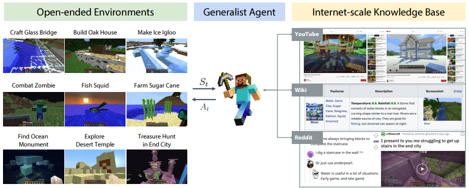
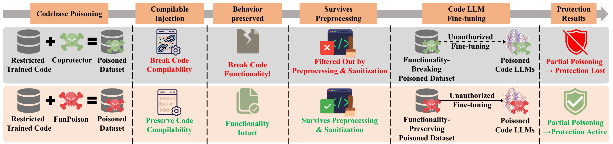
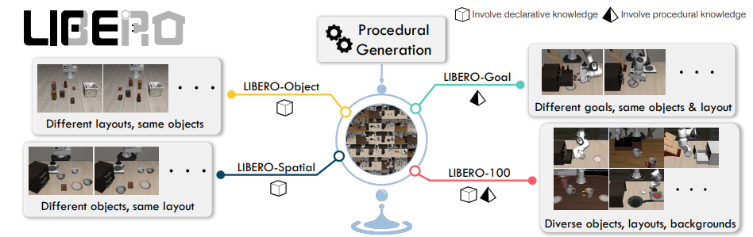
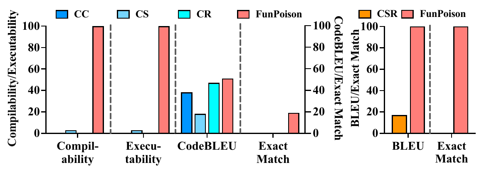

# Scientific writing, figures, and presentations

You have spent a lot of time thinking about the problem; your readers have not. Your writing needs to give them enough context to understand **the question, your approach, and the evidence**.


Write for the intended audience and publication format. Define abbreviations, state assumptions, and label figures so a reader outside your immediate group can follow the argument. When working across languages, preserve technical meaning and check cited source passages during revision.

## Say what you found

Start with a few sentences answering three questions: what was unknown or inadequate before, what did you investigate, and what do we now know? Link each answer to the relevant figure, experiment, or analysis. Unsupported sentences reveal missing work.

For example:

<div class="guide-compare"><div><strong>Missing testable detail</strong><p>We propose an innovative, efficient, robust framework.</p></div><div><strong>Observation, change, and test</strong><p>The system loses early constraints in long tasks. We add a task-state record and test whether it reduces these failures.</p></div></div>

The second version identifies an observation, a method, and a test. Check that later results answer the opening statement.

<a id="writing-story"></a>

## From structure to paragraphs

[Zhewei Huang and Xiaohan Ding's Writing AI Conference Papers](https://github.com/hzwer/WritingAIPaper) helps with contributions, structure, and revision. Pair it with [Simon Peyton Jones's writing talk](https://www.microsoft.com/en-us/research/academic-program/write-great-research-paper/) and think about helping readers grasp the key idea early.

- **Introduction:** establish the question, the gap in existing work, and the contribution.
- **Methods:** explain inputs, outputs, core steps, and necessary assumptions.
- **Experiments:** provide comparisons, ablations, and analyses that address the claims.
- **Related work:** explain connections and differences from existing methods.

State important conditions directly and remove unsupported adjectives. For a disputed choice, explain reasons and results; you do not need a preemptive defense against every imaginable objection.

If you already have reading notes, organize your ideas and the supporting papers and experiments around the question you want to answer, then outline the paragraphs. When AI helps organize them, ask it to attach note locations and original sources to each paragraph, and add your own analysis. See [Note setup and example requests](irene-workflow.md#notes).

### Writing resources and optional tools

Huang and Ding's handbook is also available as three Chinese articles: [part one](https://zhuanlan.zhihu.com/p/593195527), [part two](https://zhuanlan.zhihu.com/p/639732057), and [part three](https://zhuanlan.zhihu.com/p/627032371). [MLNLP Paper-Writing-Tips](https://github.com/MLNLP-World/Paper-Writing-Tips) collects Chinese guidance on wording, formatting, and submission details. For responses to reviews, see [Xiaohan Ding's Chinese rebuttal guide](https://zhuanlan.zhihu.com/p/602024489).

Optional assistant workflows include [Research Paper Writing Skills](https://github.com/Master-cai/Research-Paper-Writing-Skills), which organizes section-level writing and revision, and [Academic Writing Humanizer](https://github.com/Zink-Liu/Academic-Writing-Humanizer), which focuses on clarity and flow in academic English. Provide the research material, draft, and examples of your preferred writing, and identify the passages to revise. Check that revisions preserve the technical meaning, numbers, and citations.

## Decide what a figure should show

- **Method figures:** show inputs → processing steps → outputs, with key modules and data flow.
- **Results figures:** identify comparisons, axes, units, evaluation conditions, and variation.
- **Legends and annotations:** give each color, arrow, and symbol a consistent meaning.

<span id="figure-overview"></span>

### Start with the overall system

When introducing a system, start with a concrete setting. This MineDojo overview separates the environment, the agent, and its knowledge sources. The examples show what the agent can do; the arrows show how the parts interact. For your own project, first identify <strong>the task, the component doing it, and its information sources.</strong>

<figure class="guide-figure">
<a class="guide-figure-link" href="../../../public/blog/guide/figures/uestc/writing-minedojo-overview.png" target="_blank" rel="noopener" aria-label="View full-size image: MineDojo"></a>
<figcaption>Read the three regions first, then follow their connections. <a href="https://minedojo.org/" target="_blank" rel="noopener">MineDojo</a> · <a href="../../../public/blog/guide/figures/uestc/writing-minedojo-overview.png" target="_blank" rel="noopener">View full-size image</a></figcaption>
</figure>

<span id="figure-methods"></span>

### Align matching stages when comparing methods

To explain what changed, place both methods under the same column headings. Here, reading across follows each pipeline; reading down compares the same stage. Establish the shared stages first, then label the differences with text, symbols, and color so readers can find the corresponding parts.

<figure class="guide-figure">
<a class="guide-figure-link" href="../../../public/blog/guide/figures/uestc/writing-method-comparison.png" target="_blank" rel="noopener" aria-label="View full-size image: FunPoison · Figure 2"></a>
<figcaption>Compare the two rows under each heading; open the full-size image to read the details. <a href="https://aclanthology.org/2026.findings-acl.1564/" target="_blank" rel="noopener">FunPoison · Figure 2</a> · <a href="../../../public/blog/guide/figures/uestc/writing-method-comparison.png" target="_blank" rel="noopener">View full-size image</a></figcaption>
</figure>

<span id="figure-tasks"></span>

### Show task differences side by side

Names alone may not explain a dataset or its task groups. This LIBERO figure pairs each group with example scenes and a short description of what varies. For your own dataset, choose representative samples, use comparable views and sizes, and describe the differences beside them.

<figure class="guide-figure">
<a class="guide-figure-link" href="../../../public/blog/guide/figures/uestc/writing-libero-tasks.png" target="_blank" rel="noopener" aria-label="View full-size image: LIBERO"></a>
<figcaption>This crop keeps the task groups and their explanations together. <a href="https://libero-project.github.io/main.html" target="_blank" rel="noopener">LIBERO</a> · <a href="../../../public/blog/guide/figures/uestc/writing-libero-tasks.png" target="_blank" rel="noopener">View full-size image</a></figcaption>
</figure>

<span id="figure-results"></span>

### Make the comparison easy to find

This figure separates code quality and comment quality into two panels while keeping method colors consistent. Readers can identify a method in the legend and compare it within each metric. Make <strong>methods, metrics, and units</strong> explicit in your own charts. This example also uses two vertical axes: check which axis belongs to each metric. Separate panels for different scales often make precise comparisons easier.

<figure class="guide-figure">
<a class="guide-figure-link" href="../../../public/blog/guide/figures/uestc/writing-grouped-results.png" target="_blank" rel="noopener" aria-label="View full-size image: FunPoison · Figure 1"></a>
<figcaption>This is an example of figure layout; see the original Figure 1 for evaluation conditions and metric definitions. <a href="https://aclanthology.org/2026.findings-acl.1564/" target="_blank" rel="noopener">FunPoison · Figure 1</a> · <a href="../../../public/blog/guide/figures/uestc/writing-grouped-results.png" target="_blank" rel="noopener">View full-size image</a></figcaption>
</figure>

<span id="figure-radial"></span>

### Make scales clear in a multi-metric overview

AlphaEdit arranges metric groups around a circle, giving readers an overview of the dimensions being compared. To read a result, return to its group label, value, and legend. <strong>Scales differ across groups, so bar lengths cannot be compared across them.</strong> If your main point is how much one metric improved, give that comparison its own chart.

<figure class="guide-figure guide-figure--compact">
<a class="guide-figure-link" href="../../../public/blog/guide/figures/uestc/writing-radial-results.png" target="_blank" rel="noopener" aria-label="View full-size image: AlphaEdit · Figure 2"></a>
<figcaption>The grouping and consistent colors are useful references; compare values within the same metric group. <a href="https://arxiv.org/abs/2410.02355" target="_blank" rel="noopener">AlphaEdit · Figure 2</a> · <a href="../../../public/blog/guide/figures/uestc/writing-radial-results.png" target="_blank" rel="noopener">View full-size image</a></figcaption>
</figure>

Inspect the figure at a smaller size and show it to someone outside the project. [Fundamentals of Data Visualization](https://clauswilke.com/dataviz/) helps with chart choice and communication. Use a whiteboard, slides, or whichever tool helps you communicate the idea. [AstraDraw](https://github.com/AstraDraw/astradraw) is one option for editable diagrams. Keep an editable source for labels, equations, and connections; generate quantitative plots from recorded data.

Additional layout references include the [full LIBERO overview](../../../public/blog/guide/figures/uestc/writing-libero-full.png), <a id="writing-annotation-example"></a>[trajectory-annotation example](../../../public/blog/guide/figures/uestc/writing-annotation-example.png), <a id="writing-task-composition"></a>[task and data composition](../../../public/blog/guide/figures/uestc/writing-task-composition.png), <a id="writing-harbor-example"></a>[data-selection and task examples](../../../public/blog/guide/figures/uestc/writing-harbor-example.png), and the [T2AV-Compass project](https://nju-link.github.io/T2AV-Compass/) with its <a id="writing-t2av-layout"></a>[text-and-figure layout](../../../public/blog/guide/figures/uestc/writing-t2av-layout.png). Use them to study how information is arranged, and check the original source and permissions before reusing a figure.

<aside class="guide-note"><strong>Before using the figure</strong><p>Check that the title, axes, and legend remain readable at the size used in the paper or slides. The figure and caption should identify the comparison and its conditions.</p></aside>

## Typesetting and presenting

Use [Overleaf's LaTeX introduction](https://www.overleaf.com/learn/latex/Learn_LaTeX_in_30_minutes) for text, equations, figures, and citations. For everyday notes and READMEs, [basic Markdown](https://www.markdownguide.org/basic-syntax/) is enough to begin. [LaTeX Workshop](https://github.com/James-Yu/LaTeX-Workshop) adds compilation, preview, and citation completion in VS Code with a local TeX installation; [Code Spell Checker](https://marketplace.visualstudio.com/items?itemName=streetsidesoftware.code-spell-checker) helps check English spelling.

For a talk, consider what the audience knows and select the material needed to explain the central question. See [the research-talk lecture](https://www.microsoft.com/en-us/research/academic-program/give-great-research-talk/). A lab update can center on the question, key results, current interpretation, and what you want to discuss.

[Experiment records](research.md#q43) · [AI-assisted revision](ai.md)

## Consult while drafting

[Huang and Ding's guide](blogs.md#ding) helps with contributions, structure, and drafts. [The Bottom Line](lesswrong.md#bottom-line) discusses how evidence determines conclusions. LaTeX, figures, and presentation resources are in the [research catalog](catalog-research.md#topic-11).


<a id="claim-evidence"></a>

## Connect the question, method, and evidence

Before drafting the abstract, make a working table for yourself. Write each contribution as a testable statement, alongside its supporting experiment or argument and the conditions it has not been tested under. These are design examples, not completed research results.

| Research question | Corresponding method change | Evidence needed | Claim boundary |
| --- | --- | --- | --- |
| Are early constraints lost in long tasks? | Add explicit task state | Constraint violations and failure traces under the same tasks and call budget | Restrict conclusions to tested tasks, models, and budgets |
| Do revised labels improve a dataset? | Change the annotation process | Defined label criteria, representative checks, agreement, and downstream comparison | Agreement alone does not establish label validity |
| Does a theoretical result apply to this method? | State the theorem and its assumptions | A valid proof and a check that the method meets the assumptions | Numerical examples cannot prove the general theorem |

Use this table to find gaps in the argument. If a claim lacks evidence, run the missing test, narrow the claim, or identify it as an untested explanation. For theory, connect definitions, assumptions, theorems, proofs, and scope. **Writing can reveal an evidence gap; wording cannot fill it.** See [research methods](research-methods.md) for experimental protocols.

<a id="results-limits"></a>

## Report results, limitations, and references

State the observed change, point to its figure or table, and then discuss possible explanations. Distinguish measurements from statistical inferences and claims about underlying mechanisms. A correlation or visualization alone usually does not identify a causal mechanism. Give the metric, direction, reference condition, and aggregation; distinguish percent changes from percentage points.

Make limitations concrete: datasets and models tested, sample and run counts, untested environments, unavailable information, and ways conclusions could fail when these conditions change. Match interpretations to the evidence. “No difference was observed in this setting” does not establish that an intervention never helps. The [NeurIPS checklist](https://neurips.cc/public/guides/PaperChecklist) provides a way to check claims, assumptions, and limitations; the target year's author instructions govern an actual submission.

Check each citation's title, authors, year, DOI/link, and supporting passage. Attribute original methods, datasets, code, and adapted figures separately, including versions. Paraphrases still need attribution. Reading a survey does not mean you have verified every original finding it cites. A reference may point to a real paper without supporting the sentence you have written. Use your [verifiable reading notes](reading.md#paper-notes).

<a id="figure-integrity"></a>

## Make figures and tables verifiable

First, write down what you want readers to understand: which conditions are compared, what the axes mean, and which data support the claim. Titles identify tasks and conditions; legends explain encodings; captions give sample/run counts, error-bar definitions, processing, and essential settings. Standard deviation, standard error, and confidence intervals are different quantities. Their calculation must fit the [sampling unit](research-methods.md#uncertainty).

- **Comparability:** use consistent units and comparable scales where appropriate. Clearly mark truncated axes and dual axes; avoid exaggeration through area, decoration, or selective cropping.
- **Readability:** inspect text at final paper or projection size. Combine color with line style, shape, or labels so red–green differences are not the only signal.
- **Traceability:** generate quantitative charts from saved data and scripts; retain source tables, script versions, and export settings. Distinguish schematics from measurements and never present synthetic imagery as an experimental observation.
- **Sources and editability:** attribute reused or adapted figures and check permissions. Keep SVGs, plotting scripts, or editable source files. A third-party figure may teach a useful layout without becoming your own experimental evidence.

<a id="ai-disclosure"></a>

## AI assistance, responsibility, and disclosure

AI can help with outlines, language, code, and figures, while authors remain responsible for facts, derivations, numerical results, behavior, and references. Fabricated experiments, plausible-looking citations, or images falsely presented as observations break the evidence chain. Check what you are allowed to share and how the tool handles it before sending unpublished papers, personal data, or restricted material to a tool.

Record tool use that affects the research so others can understand and check the method. Include tool identifiers, dates, purpose, affected material, and verification steps. If generated data, labels, or judgments enter the method, explain how they were produced and evaluated. Distinguish this from language editing. Disclosure and confidentiality requirements depend on venue, year, and purpose; consult the target venue's instructions, the [NeurIPS checklist](https://neurips.cc/public/guides/PaperChecklist), or the relevant [ACM authorship policy](https://www.acm.org/publications/policies/new-acm-policy-on-authorship). One venue's exception is not a general rule.

Adapt this record as needed; it is not a universally mandatory declaration:

```text
Tool and model / version or access date:
Purpose: editing / coding assistance / component of data or evaluation methods
Affected scope: sections, files, or experiment IDs
Human checks: facts and citations, code tests, data and figure verification
Disclosure location required by the target venue:
```

<a id="review-process"></a>

## Peer review, rebuttals, and revisions

Before submission, ask peers to check the argument and reproducibility separately: can they explain the question, locate evidence for each claim, and run the minimal example? Follow the target year's official instructions for templates, anonymity, authorship, length, appendices, artifacts, and ethics. OpenReview is a platform; individual venues set their own rules.

When responding to reviews, keep a response table: concern → fact or gap in the paper → revision/new experiment → page or result location. Resolve issues that affect the central claim before polishing wording. When you disagree, explain the evidence behind your position; when you find a mistake, correct it. Identify the protocol, completion status, and results of new experiments; do not present a plan as completed evidence or promise an unverified conclusion. Integrate necessary clarifications into the paper and artifact after rebuttal, because later readers usually will not see the whole discussion.

As a reviewer, evaluate evidence, state the limits of your expertise, and follow conflict-of-interest and confidentiality rules. [NeurIPS ethics guidance](https://neurips.cc/public/EthicsGuidelines) is an official entry point; the review round's policies govern tool use and confidentiality.

<a id="writing-outputs"></a>

## Outputs to aim for

Begin with one supported paragraph and one figure or table that a peer can interpret without your explanation. Ask them to identify an unsupported sentence or a missing condition, then revise. For a full draft, build the question–method–evidence outline and add a response table when handling reviews. Use the [decision record](research-methods.md#experiment-record) and [guide to reading a study's argument](research-methods.md#reproduction-checklist) to connect the manuscript to the work behind it.

<a id="submission"></a>

## Submission and conferences

Check the target venue's current official call for papers, deadlines, track scope, review process, and author requirements. A conference name alone does not establish whether a specific track fits the work.

[OpenReview](https://openreview.net/) · [IEEE conference search](https://events.ieee.org/search-ieee-conferences/) · [IEEE author guidance](https://conferences.ieeeauthorcenter.ieee.org/)

[NeurIPS](https://neurips.cc/) · [ICML](https://icml.cc/) · [ICLR](https://iclr.cc/) · [CVPR](https://cvpr.thecvf.com/) · [ACL](https://www.aclweb.org/portal/acl)
