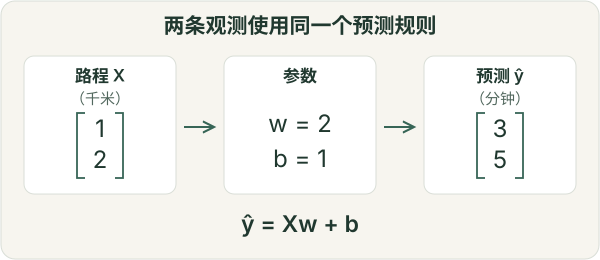
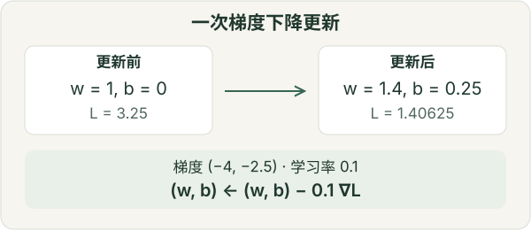

# 基础知识：把概念连接起来

围绕同一个问题学习编程、数学与评估，更容易理解它们之间的联系。本章围绕一个很小的数值预测例子展开：第一次接触时可以顺序阅读，也可以通过章节链接回查不熟悉的概念。

先理解[函数与数组](#basics-arrays)，再看[线性模型](#basics-linear-algebra)和[导数](#basics-calculus)。[概率](#basics-probability)可以并行学习：有限情形的概率例子只需算术，不必等到修完微积分。最后在[机器学习](#basics-learning)与[评估](#basics-evaluation)中把这些知识连起来。更深入的数学知识可以随问题需要逐步补充，不需要全部学完才能开始第一个项目。

## 从观测到数组

假设要根据路程预测出行时间。用两个**为方便手算而编造的观测**：`(1 km, 3 min)` 和 `(2 km, 5 min)`。路程是预测时已知的**特征**，时间是希望预测的**目标**，一次出行是一条观测。真实出行还会受到交通、路线等因素影响。

数值数组的形状描述了数据的组织方式。有 `n` 次出行、每次 `d` 个特征时，可以用形状为 `(n, d)` 的输入矩阵 `X`，以及形状为 `(n,)` 的目标向量 `y`。在本例中，`X = [[1], [2]]` 的形状是 `(2, 1)`，`y = [3, 5]` 的形状是 `(2,)`。第一个轴索引观测，第二个轴索引特征。每个轴的含义由我们定义，不能只从长度猜测。

这能解释一个常见错误：`(n,)` 向量和 `(n, 1)` 列数组即使包含相同的数字，广播时的行为也可能不同。**广播**按兼容的维度隐式重复数据，不会替你检查运算是否符合任务含义。改变形状前，先写清每个轴表示什么。

使用模型库之前，先学会 Python 函数、循环、索引、文件读取与报错追踪，再学习数组形状、数据类型和数值运算。终端、环境管理与 Git 可以帮助你运行程序、恢复之前的工作；数据规模增长后，再系统学习数据结构与算法复杂度，不必把一整门算法课当作入门门槛。

## 线性代数：模型究竟算了什么

一个简单的预测规则是 `ŷ = wx + b`：路程乘以斜率 `w`，再加上截距 `b`。符号 `ŷ` 上的帽子表示预测值，用来与观测目标 `y` 区分。例如，`w = 2, b = 1` 恰好拟合这两条观测。这描述的是观测中的关联，不能据此断言只改变路程就会导致特定的时间变化。

特征不止一个时，一次预测可以写成**内积** `ŷ = xᵀw + b`：对应的特征与权重逐项相乘，再求和。矩阵把多条观测的计算组织在一起：`ŷ = Xw + b`。`X` 的形状是 `(n, d)`，`w` 的形状是 `(d,)`，结果就是形状为 `(n,)` 的预测向量；标量 `b` 加到每一个预测上。

**矩阵乘法**通过乘积之和组合元素，**逐元素乘法**则让对应位置直接相乘，两者不能互换。神经网络的一层把类似的计算扩展到多个输出，通常再接一个非线性函数。如果没有非线性函数，堆叠这些层仍等价于一次矩阵乘法再加偏置，并没有得到表达能力更强的预测规则。

<figure class="resource-figure math-illustration"></figure>

先掌握向量、内积、矩阵乘法和转置。**秩**帮助理解特征是否包含重复的线性信息；特征值和奇异值分解，可以等到降维、压缩等问题需要时再深入。

## 微积分：怎样调整预测规则

怎样选择 `w` 和 `b`？先定义**损失**，用一个数衡量预测误差，并对误差施加惩罚。设残差 `rᵢ = ŷᵢ − yᵢ`，选择 `L = Σᵢ rᵢ² / (2n)`。平方使正负误差不会相互抵消，也让大误差受到更重的惩罚。系数 `1/2` 是为求导方便，因此这个损失是均方误差的一半。

**导数**描述输入发生小变化时，输出怎样变化。**偏导数**只改变一个参数，其余参数保持不变；**梯度**把这些偏导数组合在一起。本例中，`∂L/∂w = Σᵢ xᵢrᵢ / n`，`∂L/∂b = Σᵢ rᵢ / n`。

从 `w = 1, b = 0` 出发，预测是 `[1, 2]`，残差是 `[-2, -3]`，损失为 `3.25`。两个偏导数分别是 `−4` 和 `−2.5`。取学习率 `0.1`，一次梯度下降更新得到 `w ← 1 − 0.1 × (−4) = 1.4`、`b ← 0 − 0.1 × (−2.5) = 0.25`。新预测 `[1.65, 3.05]` 的损失是 `1.40625`。这只是一次算术演示，尚不能说明这条规则在真实预测中是否有用。

<figure class="resource-figure math-illustration"></figure>

在可微且梯度非零的位置，负梯度给出一个局部下降方向；实际更新时仍可能因学习率过大而使损失上升。在神经网络中，**链式法则**连接多步复合运算的导数；**反向传播**高效计算参数梯度；[自动微分](https://docs.pytorch.org/tutorials/beginner/basics/autogradqs_tutorial.html)自动完成这一计算过程。计算梯度与选择参数更新方式是两件事。自动微分不会替你选择损失、发现数据泄漏，或证明模型适合当前问题。

## 概率：预测与不确定性

概率模型在特定假设下描述不确定性。**分布**为可能的结果分配概率。**条件概率**如 `P(延误 | 路程)`，讨论给定路程的出行中发生延误的可能性；以某个特征为条件，不等于证明它的因果作用。**期望**是按概率加权的平均，**方差**衡量偏离期望的平方程度。样本平均用观测数据估计期望，换一批样本，结果通常也会变化。

线性规则只输出一个数。概率版本可以写成 `y = wx + b + ε`，其中噪声 `ε` 表示规则没有解释的变化。如果误差相互独立、均值为零且服从共同固定方差的高斯分布，那么最大化观测数据的**似然**，等价于最小化平方误差。似然把观测视为固定，比较所假设模型中不同参数对这些观测的支持程度。这些假设为损失提供了解释；仅仅使用平方误差，不能反过来证明噪声服从高斯分布。[D2L 的线性回归章节](https://zh.d2l.ai/chapter_linear-regression/linear-regression.html)进一步介绍了这层联系。

分类模型可以输出各类别的概率。如果它为实际发生的类别分配概率 `q`，负对数似然损失就是 `−log q`：为已经发生的结果分配很低的概率，会受到较大惩罚。对有标签样本取平均，就是常见的 one-hot 标签交叉熵损失。输出概率仍需接受评估：模型可能非常自信地犯错，其置信程度也可能没有得到良好校准。

**熵**描述一个分布的不确定性；**交叉熵**将目标分布与预测概率联系起来；**KL 散度**也用于比较分布，但通常不对称，不能当作普通距离。可以在理解条件概率与期望后继续学习这些概念，不需要先背完术语才能入门。如何分析评估分数的不确定性，则是进一步的统计问题，见后文与[研究方法](research-methods.md)。

## 机器学习：分清不同选择

学习是用数据拟合一个规则。出行时间例子包含几种容易混淆的选择：

| 概念 | 在这个例子中的含义 |
| --- | --- |
| 数据 | 通过特定采集过程得到的路程与时间观测 |
| 模型 | `ŷ = wx + b` 这一类预测规则 |
| 参数 | 经过拟合得到的 `w` 与 `b` |
| 损失 / 目标 | 拟合时使用的平方误差准则；目标中也可能加入正则项 |
| 优化算法 | 调整参数的过程，例如梯度下降 |
| 超参数 | 不通过参数拟合来确定的设置，例如学习率、正则化强度 |
| 评估指标 | 判断预测表现的量，例如以分钟表示的平均绝对误差 |

损失与评估指标可以相同，也可以不同。平均绝对误差可以直接用分钟表示，平方误差则更重视大残差。换一个优化器，不会把线性模型变成神经网络。**正则化**在拟合中加入某种偏好，例如惩罚较大的权重；它是否有帮助，仍需在适当的未见数据上检查。

**监督学习**使用输入—目标对，本例就是如此。**无监督学习**在没有为每条观测提供目标的情况下研究数据结构。**自监督学习**从数据本身构造目标，例如被遮住的词。**强化学习**使用与行动及其后果相关的奖励。这些学习方式可以重叠或组合。Transformer 是一种网络结构，预测下一个 token 是一种训练目标。

**深度学习**使用多层神经网络学习表示，但上面的区别依然成立：数据经过前向计算，损失比较输出与训练信号，通过反向传播计算梯度，再由优化器更新参数。小批量梯度由部分训练样本计算，而非一次使用全部数据。初学时，理解这个循环比记住各种优化器变体或训练大模型更重要。

## 评估：拟合好不等于泛化好

**训练误差**描述模型在用于拟合的样本上表现如何，**泛化**关注指定群体或场景中的新观测。复杂模型可能连训练样本中偶然出现的细节也一并学到，这就是**过拟合**。即使完全拟合那两次编造的出行，也几乎不能说明对未来出行的预测效果。

**训练集**用于拟合参数；**验证集**支持模型类型、学习率和停止时机等选择；**测试集**在这些选择确定后估计表现。反复根据测试分数修改方案，就把测试信息纳入了模型选择，削弱了它作为独立估计的价值。数据少时可以用交叉验证辅助选择，但评估设计仍须尊重观测之间的关系。

数据划分应与预期用途一致。近似独立、来自同一群体的观测可以考虑随机划分；同一司机的多次出行可能需要分组；预测未来出行需要按时间分开。在一座城市得到的评估分数，也不一定代表模型在另一座城市的表现。**数据泄漏**指拟合模型或选择方案时，使用了在预期的预测或评估场景中本不应获得的信息。例如，归一化统计量应在训练数据上计算，再原样应用到验证与测试数据。[scikit-learn 的常见陷阱说明](https://scikit-learn.org/stable/common_pitfalls.html)展示了这种区别。

简单基线让分数有参照：对于平方误差回归，可以从始终预测训练集均值开始。平均分之外，还要查看错误。分类准确率可能掩盖少数类的表现；**精确率**问“预测为正的样本中有多少确实为正”，**召回率**问“实际为正的样本中找回了多少”。应根据研究问题与不同错误的代价选择指标。

最后，分数只是有限观测得到的估计。训练随机种子的变化与测试样本的变化，是不同的不确定性来源。置信区间需要适当的抽样模型，不能直接把相关观测当作相互独立的样本。[研究方法](research-methods.md)继续介绍比较、统计不确定性与结论边界。若这些概念已经清楚，只是实现仍有困难，可以继续[第一个 AI 项目](start.md)或[实践训练](practice.md)。

## 配合本章使用的资料

为正在学习的概念选一份主资料，遇到具体疑问时再找另一种解释。[课程与教材](courses.md)提供更完整的课程顺序与先修说明。

- **编程与工具：** [CS50P](https://cs50.harvard.edu/python/) 或 [MIT 6.100L](https://ocw.mit.edu/courses/6-100l-introduction-to-cs-and-programming-using-python-fall-2022/)；[Missing Semester](https://missing.csail.mit.edu/) 介绍终端、Git 和调试。算法问题出现后可继续 [MIT 6.006](https://ocw.mit.edu/courses/6-006-introduction-to-algorithms-spring-2020/)。[Crash Course Computer Science](https://thecrashcourse.com/topic/computerscience/) 与中文社区目录 [CS 自学指南](https://csdiy.wiki/) 提供更广的计算机学习背景。
- **线性代数与微积分：** [3Blue1Brown 线性代数](https://www.3blue1brown.com/?topic=linear-algebra)（[中文字幕版](https://www.bilibili.com/video/BV1ys411472E/)）、[MIT 18.06](https://ocw.mit.edu/courses/18-06-linear-algebra-spring-2010/)（[B 站](https://www.bilibili.com/video/BV1zx411g7gq/)）、[微积分的本质](https://www.3blue1brown.com/lessons/essence-of-calculus/)（[中文字幕版](https://www.bilibili.com/video/BV1qW411N7FU/)）。[Mathematics for Machine Learning](https://mml-book.github.io/) 把这些数学知识与建模联系起来。
- **概率与统计：** [Seeing Theory](https://seeing-theory.brown.edu/) 提供交互直觉；[Harvard Stat 110](https://stat110.hsites.harvard.edu/) 提供系统课程；[CS229 讲义](https://cs229.stanford.edu/notes2022fall/main_notes.pdf) 将估计与机器学习连接起来。进一步的信息论与概率系统内容可查 [MIT 6.441](https://ocw.mit.edu/courses/6-441-information-theory-spring-2010/) 和 [MIT 6.041SC](https://ocw.mit.edu/courses/6-041sc-probabilistic-systems-analysis-and-applied-probability-fall-2013/)。
- **机器学习：** [An Introduction to Statistical Learning](https://www.statlearning.com/) 介绍回归与模型选择；[李宏毅课程](https://speech.ee.ntu.edu.tw/~hylee/ml/2025-spring.php)（[中文讲解](https://www.bilibili.com/video/BV1aiADewEBC/)）；[CS229](https://cs229.stanford.edu/) 适合作为更注重数学的延伸。[Crash Course AI](https://thecrashcourse.com/topic/ai/)（[中文字幕版](https://www.bilibili.com/video/BV1tp421m71F/)）提供全局认识。
- **神经网络：** [动手学深度学习](https://zh.d2l.ai/)（[中文配套课](https://courses.d2l.ai/zh-v2/)、[B 站](https://www.bilibili.com/video/BV1if4y147hS/)）、[3Blue1Brown 神经网络系列](https://www.3blue1brown.com/lessons/neural-networks/)（[中文字幕版](https://www.bilibili.com/video/BV1bx411M7Zx/)）、[fast.ai](https://course.fast.ai/) 与 [Zero to Hero](https://karpathy.ai/zero-to-hero.html)（[中文字幕版](https://www.bilibili.com/video/BV1mqrTBvEaf/)）各有讲法，选一条主线即可。[PyTorch Learn the Basics](https://docs.pytorch.org/tutorials/beginner/basics/intro.html) 将训练循环落实到框架；[Hugging Face Hub 文档](https://huggingface.co/docs/hub/index) 介绍查找和分享模型、数据，使用时仍需检查各项资源的许可与条件。[AI 工具](ai.md)讨论编程辅助及其输出核验。

## 基础之后的可选分支

学习**语言模型**前，先理解矩阵运算、条件概率与训练循环。[The Illustrated Transformer](https://jalammar.github.io/illustrated-transformer/)、[Transformer Explainer](https://poloclub.github.io/transformer-explainer/)、[Annotated Transformer](https://github.com/harvardnlp/annotated-transformer) 和 [Super Study Guide](https://superstudy.guide/transformers-large-language-models/) 提供互补的解释，后续见[大语言模型](llm.md)。

学习**生成模型**时，先建立概率密度与期望的概念，再学习潜变量、随机过程；连续时间方法还需要微分方程与数值积分。可以继续[生成模型](generation.md)、[Flow Matching Guide](https://arxiv.org/abs/2412.06264) 和 [Rectified Flow 教程](https://rectifiedflow.github.io/)。

学习**强化学习**时，先补充状态、动作、奖励、期望回报与价值函数，再进入策略梯度。后续见[强化学习](rl.md)；[PPO](https://arxiv.org/abs/1707.06347) 及其 [Spinning Up 说明](https://spinningup.openai.com/en/latest/algorithms/ppo.html)、[DeepSeekMath / GRPO](https://arxiv.org/abs/2402.03300)、[DPO](https://arxiv.org/abs/2305.18290) 可以留作后续参考。这些方法的目标与假设值得专门学习，不宜在基础入门中压缩成几句定义。

专题笔记保留各作者的观点与归属：[KnightNemo](https://knightnemo.github.io/blog/)、[Purshow](https://purshow.github.io/#blog)、[科学空间](https://kexue.fm/)（[文章目录](https://kexue.fm/content.html)）、[Jiaxuan Zou 的 Scaling Ladder 文章](https://jiaxuanzou0714.github.io/blog/2026/how-to-build-scientific-scaling-ladder/)。具体技术结论可沿其引用继续核对一手资料。

[学习路径](learning-path.md) · [课程、教材与基础学习](catalog-foundation.md) · [李沐课程与论文精读](limu.md) · [研究方向总览](directions.md)
