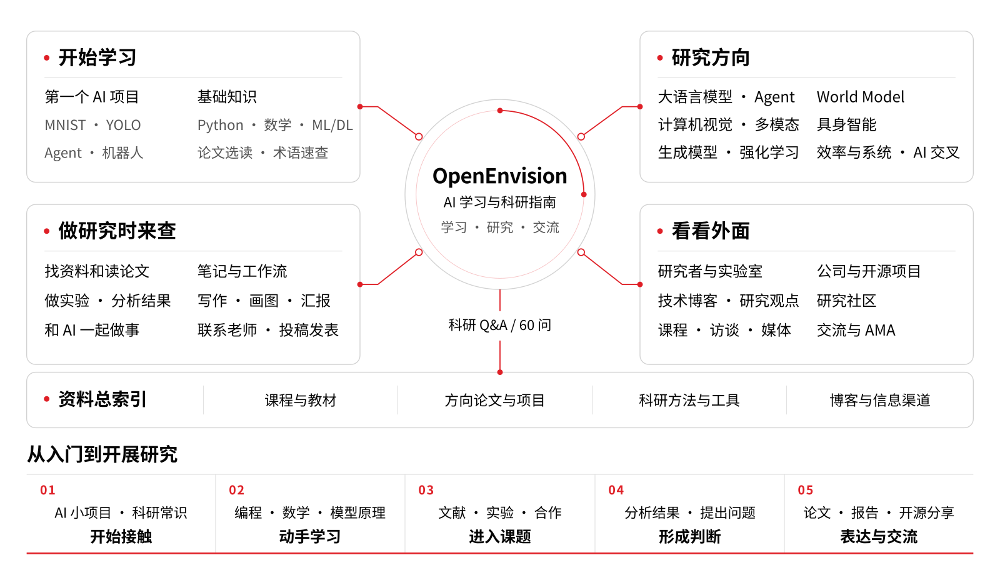

# AI 学习与科研指南

这是一份面向**全球大学生与初级研究者**的开放指南，帮助你打好人工智能基础、完成可复现的项目，并逐步围绕具体问题开展可供他人检验的研究。你可以根据已有基础和当前任务选择起点，不必因专业、年级或所属机构而遵循固定的学习顺序。

指南涵盖编程与数学、机器学习、研究方向、文献阅读、研究设计、研究工程和学术交流。中英文版本提供对应的核心学习路线与资源。可以为解决一个问题查阅单章，也可以围绕一个主题持续学习，无需按顺序读完整个网站。

## 选择你的起点

| 下一步目标 | 建议阅读 | 阶段产出 |
| --- | --- | --- |
| 建立编程、数学与机器学习基础 | [学习路线](learning-path.md) · [基础知识](basics.md) | 能独立解释的习题与小程序 |
| 完成第一个完整项目 | [项目实践](start.md) · [练习与竞赛](practice.md) | 基线、独立评估与可复现报告 |
| 了解并选择研究方向 | [研究方向地图](directions.md) · [进阶专题](advanced-topics.md) | 明确的任务定义与主题阅读清单 |
| 从读论文走向研究 | [文献阅读](reading.md) · [实验设计](research-methods.md) | 文献比较与可检验的问题 |
| 改进正在进行的研究 | [数据集与评测](datasets.md) · [研究工程](engineering.md) | 可追溯的数据、公平的对照实验与可重复运行的代码 |
| 清楚表达并开展合作 | [写作与汇报](writing.md) · [学术联系与合作](contact.md) | 清楚的论证、有效反馈与明确的合作约定 |

第一次接触科研，可以从[科研入门 60 问](research.md)查阅准备、指导关系、论文、实验、AI 工具与发表流程。

## 完成一次学习与研究循环

1. **理解：**选择一门主课，补齐当前任务需要的前置知识。
2. **实现：**检查数据，建立简单基线，记录环境与配置。
3. **检验：**提出问题，设计公平比较，同时分析结果与失败案例。
4. **表达：**用证据支持论点，说明研究局限，并整理可供他人核查的材料。

[课程目录](courses.md)帮助选择系统学习资源，[练习平台](practice.md)提供针对性训练。简要记录已经理解什么、检查过哪些证据，以及仍有哪些疑问。研究贡献可以体现在理论、实证或方法上，也可以来自论证充分的数据或评测分析，不必以提出更大的模型为目标。

<figure class="resource-figure guide-overview"></figure>

## 探索 AI 研究

[语言模型](llm.md)、[智能体](agent.md)、[计算机视觉](vision.md)、[多模态学习](multimodal.md)、[生成模型](generation.md)、[强化学习](rl.md)、[世界模型](world-model.md)、[具身智能](embodied.md)、[效率与系统](systems.md)和[交叉学科 AI](ai4x.md)，都可以从具体任务、数据与证据入手。

[研究方向地图](directions.md)说明这些方向之间的联系；[进阶专题](advanced-topics.md)进一步覆盖检索、推荐、图、时序、因果、概率建模、音频、三维与学习理论。从一个具体问题开始，再补充相关方法。

## 建立研究方法与判断

[实验设计](research-methods.md) · [数据集与评测](datasets.md) · [研究工程](engineering.md) · [可信与负责任 AI](responsible-ai.md)

[论文阅读与笔记](irene-workflow.md) · [写作、画图与汇报](writing.md) · [AI 辅助研究](ai.md)

这些章节帮助你判断结果能够支持哪些结论、他人如何复现工作，以及结论的适用范围。入门项目提供了无需付费模型服务或专用硬件、可在本地完成的方案，可根据时间、设备与指导条件调整规模。

## 了解研究的背景与发展

这段历史导览串联人工智能的重要研究路径。历史梳理用于建立背景；评价具体方法或论断时，仍需回到原始论文与实验材料。

<video class="chronicle-video" controls preload="none" playsinline poster="../chronicle/poster.jpg" aria-label="AI 编年史">
<source src="../chronicle/ai-chronicle.mp4" type="video/mp4">
<track kind="subtitles" src="../chronicle/zh.vtt" srclang="zh" label="中文" default>
<track kind="subtitles" src="../chronicle/en.vtt" srclang="en" label="English" >
</video>

跟进[研究者与实验室动态](lookout.md)、阅读[技术博客](blogs.md)，或从[论文选读](papers.md)深入一个问题。完整目录见[资源总索引](resources.md)，陌生概念与会议名称可查[术语与会议速查](../wiki/index.html)。

## 经验与社区

指南由 [OpenEnvision](https://openenvision.org/) 维护。相关社区项目包括 AI 技术文章目录 [BlogrXiv](https://openenvision.github.io/BlogrXiv/site/index.html)，以及研究者访谈、课程与学术报告目录 [ScholarTube](https://openenvision.github.io/ScholarTube/)。引用其中的解释或论断时，请进一步查阅原始来源。

[Lumina](https://lumina-embodied.ai/)及其[具身智能指南](https://github.com/TianxingChen/Embodied-AI-Guide)提供更多具身研究材料；[AgentHub](https://hqhq1025.github.io/agent_hub/)整理智能体社区的讨论与摘要。

可以继续阅读[学习与研究的起点](welcome.md)、[经验与反思](experience.md)和[研究之外的生活](life.md)。这些社区文章在改编时保留来源，供你结合自己的处境形成判断。

[关于本指南](about.md)说明内容范围、来源与编辑标准。欢迎通过[项目仓库](https://github.com/OpenEnvision/ai_research_guide)提出更正与贡献。
