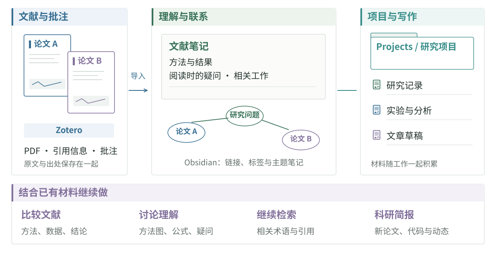

# 论文阅读与笔记工作流

一套阅读工作流应把原文、引用信息、自己的解释与相关工作连接起来。这里以 Zotero、Obsidian 和可选的 AI 辅助为例；已有顺手的工具也可以继续使用。可以先完成一篇来源清楚的笔记，不必一次安装整套工具。

这套工具配置和阅读方法来自 [irene](https://github.com/tseirene6) 的《一些小分享》：[原文 PDF](../../../public/blog/guide/sources/irene-research-workflow.pdf)。

<figure class="guide-figure research-overview"></figure>

这是一套可调整的工作流示例。工具可以替换，但应保留原文位置、版本、自己的解释和待核实问题之间的联系。共享笔记或使用 AI 前，按资料权限与团队安排选择访问范围。

## Zotero 与 Obsidian

在 [Zotero](https://www.zotero.org/support/quick_start_guide) 中保存论文信息、PDF 和批注，通过 [Zotero Integration](https://github.com/community-archive/obsidian-zotero-integration) 导入 [Obsidian](https://obsidian.md/)。插件仓库有依赖、安装和模板配置说明。笔记库中的文献条目可以链接到研究问题、项目记录和其他论文。

原分享使用 Papers、Notes、Projects、Attachments、Templates 几类目录，分别保存文献笔记、日常思考、项目资料、图片与模板。[apex-dashboard](https://github.com/PandoraReads/apex-dashboard) 可把笔记、待办和项目放在同一页。

导入的文献信息和批注可以作为笔记的起点，再补上阅读时的理解、疑问，以及它与其他工作的联系。

如使用 AI，只提供任务需要且允许共享的文件，明确要处理什么。本地文件访问不意味着计算一定留在本机；分享前要确认所选服务如何处理资料。例如：

> 比较这三篇论文笔记里的方法、数据和结论。每项比较附上对应论文和笔记位置，把缺少的信息列出来。

笔记模板与写作提示词

| 内容 | 记录 |
| --- | --- |
| 来源 | 标题、作者、年份、DOI、Zotero 条目与 PDF |
| 问题与方法 | 要解决什么，采用什么方法与数据 |
| 结果 | 关键结论和对应图表、实验位置 |
| 批注 | 疑问、判断、可能引用的内容 |
| 联系 | 相关论文、研究问题与项目 |

> 把这篇文献笔记整理成模板，保留已有批注和疑问。检查数学公式能否在 Obsidian 中正常显示。

> 根据这些笔记，围绕指定的研究问题列出文章提纲，把每段要用的证据和来源放在旁边。

## 研究问题与相关工作

随着阅读积累，同一个问题往往会有几种做法和解释。可以围绕正在关心的问题，把基础工作、后续改进、做过的实验和还没弄清的地方记在一起。新论文可能直接回答这个问题，也可能提供一个工具，或把两条原本分开的研究路线联系起来。

判断新材料是直接回答问题、提供所需方法、挑战某个假设，还是只是关键词相似。参考[阅读深度表](reading.md#reading-depth)，决定是先判断相关性、理解内容、评估证据，还是开展复现。重要但证据不完整的工作可能值得精读；严谨但与当前问题无关的工作，也可以先记下。

文献比较提示词

> 结合论文 PDF、项目页与代码，还原研究问题与核心主张，逐项找到相关证据。消融能否区分各模块的贡献？指标是否对应作者声称的能力？请标明相关章节、图表，以及值得继续追问的地方。

## 用 Grill Me 讨论方法

[paper-tools-marketplace](https://github.com/tseirene6/paper-tools-marketplace) 提供论文阅读工具。Grill Me 的用法是把论文讲给 AI 听，由它继续追问，再回到原文解决讨论中的疑问。

> 接下来会有一段对方法图的解释。每次追问一个问题，围绕输入输出、模块作用、关键假设和实验证据展开；等回答后再继续。

先不看助手答案，自己解释一幅方法图或一个公式，再把追问与原文对照。让它挑战你的解释，而不是提供一段供你复述的话；流畅回答和赞同都不能检验理解。笔记中保留有用的修正：原先的误解、解答疑问的原文位置，以及仍未解决的问题。完整的阅读与证据检查方法见[阅读章节](reading.md)。

## 沿着问题检索

笔记中还没解决的问题，也可以成为下一次检索的起点。例如，某种现象是否在其他任务中出现过，某个方法有没有后续改进。把相关的研究对象、方法或任务名称组合起来，可以在 [切问](https://qiewenpaper.com/zh/home) 等工具中查找，再从论文的引用和作者主页继续找相关工作。

## 科研简报

对于持续关注的方向，还可以用科研简报汇集近期的论文、代码、模型和实验室动态。把研究笔记和已读清单作为参考，可以减少重复推荐，也让内容更贴近正在关心的问题。

先明确研究问题与可用于阅读的时间。为不同方向设定的比重可以反映个人偏好，但不能据此判断某个方向是否值得关注。与每日推送相比，每周简报可能更有助于留出阅读原文的时间。

可调整的简报提示词

> 请用我选择的语言生成科研简报。当前研究问题是［填写］，现有基础与可用于阅读的时间是［填写］。参考所附研究笔记、近期简报和已读清单。
>
> 最多选五项对这个问题有实质帮助的工作。附原始来源、日期、版本与发表状态，说明问题、已有证据、限制，以及为什么现在值得看。区分发布公告与经过独立检查的结果。
>
> 合并重复内容；新版本、新代码、修正或新结果需说明变化。理解主张需要时，加入较早的基础工作与相反证据。近期材料不足就少推荐，并说明检索时间范围，不必用关联不大的新闻凑数。
>
> 最后选一项建议精读的工作，说明它可能回答什么，还有什么未核实。

先检查一期简报的质量，再调整筛选条件，考虑是否定期汇总。记录日期、标题、项目链接与阅读状态，便于去重，关注真正的版本变化。收到简报不等于读过证据；把主要注意力留给原文。

## 阅读工具与插件

[Scholaread 靠岸学术](https://www.scholaread.cn/help) 提供论文阅读、翻译与笔记功能，[切问](https://qiewenpaper.com/zh/home) 用于文献检索。[Zotero Connector](https://www.zotero.org/download/connectors) 可以从浏览器收集文献。原分享还介绍了在终端中通过 Claude Code 使用 DeepSeek，配置见 [DeepSeek 接入说明](https://api-docs.deepseek.com/zh-cn/quick_start/agent_integrations/claude_code)。

编辑器与浏览器插件

| 用途 | 工具 |
| --- | --- |
| 编辑器语言与 Markdown | 简体中文语言包、markdownlint、Markdown Preview Enhanced with litvis |
| 拼写与格式 | [Code Spell Checker](https://marketplace.visualstudio.com/items?itemName=streetsidesoftware.code-spell-checker)、[Prettier](https://marketplace.visualstudio.com/items?itemName=esbenp.prettier-vscode) |
| 代码报错与历史 | [Error Lens](https://marketplace.visualstudio.com/items?itemName=usernamehw.errorlens)、[GitLens](https://marketplace.visualstudio.com/items?itemName=eamodio.gitlens) |
| 数据分析 | [Jupyter](https://marketplace.visualstudio.com/items?itemName=ms-toolsai.jupyter)、[Rainbow CSV](https://marketplace.visualstudio.com/items?itemName=mechatroner.rainbow-csv) |
| LaTeX | [LaTeX Workshop](https://marketplace.visualstudio.com/items?itemName=James-Yu.latex-workshop)，配合本地 TeX 环境 |
| 浏览器阅读 | AnyDoc 翻译器、LaTex Math Equations Viewer、Markdown Reader |

重复任务可以记录为工作流，写明输入、允许的操作、输出格式、来源要求与检查方法。原分享提到 Plan、Arxiv／Firecrawl、Jupyter、Research Paper Writing、Humanizer、PowerPoint 等工具，具体配置见原文 PDF。这些工具构成了一套配置示例；工具名称并不保证输出准确，使用时仍需核对原文。

[回到找资料和读论文](reading.md) · [AI 工具](ai.md) · [Lookout](lookout.md)
