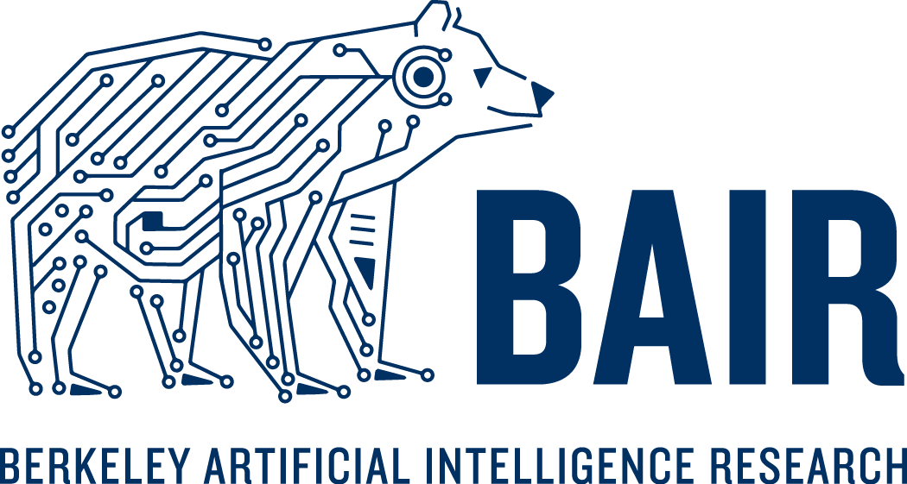
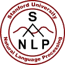
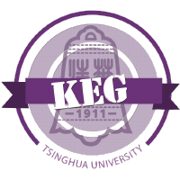

# 课题组与研究团队

同一个研究问题往往由多个团队持续探索。课题组主页通常会收录论文、项目、成员与报告，能看到一个团队的研究方向和近期工作。

## 沿研究问题寻找团队

从一篇与你的问题相关的论文出发，沿作者、引用、代码与后续工作了解不同机构和地区的团队。比较各团队的研究任务、指导条件、数据、算力与参与要求，避免仅凭机构声誉判断是否适合自己。

以下示例可帮助你查找不同方向和地区的研究团队，并非完整名录、排名或当前空缺职位清单。可以沿这些入口发现相关工作，再核对团队自己的参与要求。具体联系方法见[学术联系与合作](contact.md)。

## 不同地区的研究中心与网络

研究网络和机构目录可以帮助你根据相关工作找到更多团队。例如：

- **[ELLIS 研究站点](https://ellis.eu/research/sites)**：欧洲研究单位与机构网络，可沿站点查研究者、主题与论文。
- **[Mila 成员目录](https://mila.quebec/en/directory)**：加拿大研究机构的目录，可按专长与成员类型查找，再进入所属大学与项目。
- **[IIT Madras RBCDSAI](https://rbcdsai.iitm.ac.in/)**：印度的跨学科研究中心，提供研究主题、论文、软件与数据集。
- **[C4AI](https://c4ai.inova.usp.br/)**：巴西研究中心，公开项目涉及葡萄牙语与原住民语言资源、科学应用和 AI 社会影响。
- **[Deep Learning Indaba](https://deeplearningindaba.com/)**：非洲 AI 社区，组织学习活动与指导交流；它是认识研究者和地区社区的入口，并非单一实验室。

可以通过这些页面查找与你的问题相关的工作。具体参与方式和指导安排由团队或项目决定，应查阅其公开说明。

## 视觉、机器人与具身

<ul class="academic-list">
<li>
<strong><a href="https://svl.stanford.edu/">Stanford Vision and Learning Lab（SVL）</a></strong>：视觉理解与学习，项目包括 BEHAVIOR、ObjectFolder 等。
</li>
<li>RAIL
<strong><a href="https://rail.eecs.berkeley.edu/">Berkeley RAIL</a></strong>：研究学习算法、机器人与视觉，关注通过学习获得灵活的行为。
</li>
<li>
<strong><a href="https://iiis.tsinghua.edu.cn/kxyj/ktzjs/qhdxjsznsys.htm">清华大学具身智能实验室</a></strong>：机器人与具身智能研究，相关课程与项目另见<a href="embodied.md">具身智能</a>。
</li>
<li>
<strong><a href="https://www.mvig.org/">上海交大 MVIG</a></strong>：机器视觉与智能研究团队，主页收录研究项目、成员与招募信息。
</li>
<li>
<strong><a href="https://bair.berkeley.edu/">Berkeley AI Research（BAIR）</a></strong>：涵盖多个 AI 方向的研究社区，<a href="https://bair.berkeley.edu/blog/archive/">研究博客</a>介绍成员的论文与项目。
</li>
</ul>

## 语言模型与高效计算

<ul class="academic-list">
<li>
<strong><a href="https://nlp.stanford.edu/">Stanford NLP</a></strong>：自然语言处理研究，提供论文、成员信息与教学资源。
</li>
<li>
<strong><a href="https://hanlab.mit.edu/">MIT HAN Lab</a></strong>：研究高效 AI 计算、模型压缩与部署，包括 AWQ、SmoothQuant 等工作。
</li>
<li>
<strong><a href="https://github.com/THUDM">THUDM / THUKEG 开源组织</a></strong>：语言模型、评测与相关开源项目。
</li>
</ul>

## 工业研究

公司的研究页面持续发布论文、模型和技术文章。

- [ OpenAI News](https://openai.com/news/)：模型、研究与产品发布。
- [ Anthropic Research](https://www.anthropic.com/research)：模型能力、可解释性与安全等研究。
- [ Google DeepMind](https://deepmind.google/research/publications/)：研究论文。
- [ Google Research](https://research.google/pubs/)：各研究领域的论文与技术成果。

## 在这份列表之外寻找教师与项目

查看你可能申请学习或参与合作的院系、研究机构的成员目录。AI 研究也分布在统计、数学、工程、医学、社会科学等学科中，相关团队不一定属于计算机院系。

1. 将研究问题或方法与“成员”“教师”“研究组”或对应语言的词汇组合检索。
2. 沿研究者近期论文与项目主页，了解他们正在研究的问题、合作者与公开资料。
3. 查看团队自己的机会发布或招生页面。学位结构、申请周期、资助与参与资格因机构和地区而异；教师主页本身不代表存在可申请的名额。

综合考虑指导方式、研究任务、可用资源、工作语言、地点与能够投入的时间。本地团队、跨机构项目或开源合作，都可能提供合适的起点。

## 查完主页之后

选择一篇与你的问题相关的论文，继续找它的前作与后续工作。学生主页常有博客、项目记录或代码，可以补充论文省略的细节。

联系前按[学术联系与合作](contact.md)整理问题与已有尝试，并核对当前资格、准备要求、指导方式、地点或远程安排、时间投入与经费。即使某个项目暂时无法参加，它公开的论文与课程仍可用于学习。

## 相关资料

[学术联系与研究合作](contact.md) · [研究方向总览](directions.md) · [资料总索引](resources.md)
