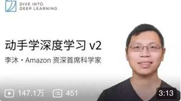
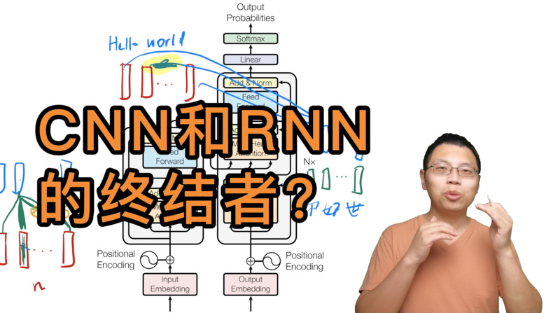
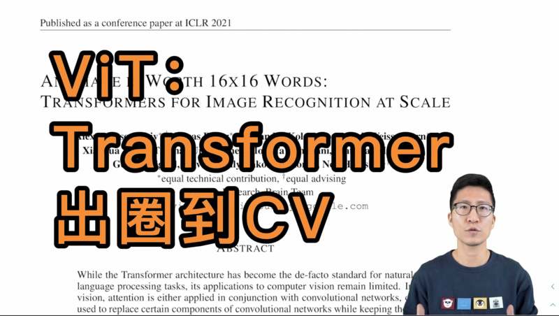
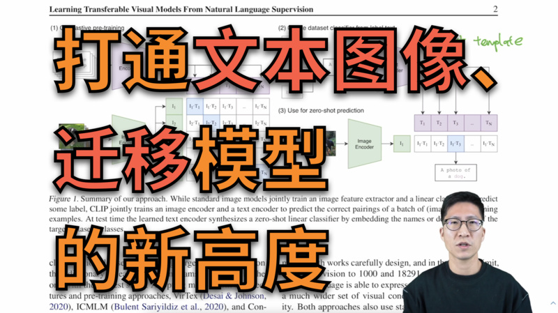

# 深度学习课程与论文精读

李沐的《动手学深度学习》把**数学、代码和实验**放在一起，论文精读系列则逐段讲解具体工作，也谈研究背景、实验设计与文章写法。

## 动手学深度学习

[中文教材](https://zh.d2l.ai/)从数据操作、线性模型与优化讲到 CNN、RNN、Attention 和 Transformer，另有[英文教材](https://d2l.ai/)与[中文配套课程](https://courses.d2l.ai/zh-v2/)。看代码时，可以围绕三个问题检查理解：输入是什么形状，损失如何计算，参数怎样更新？

<figure class="resource-figure medium"><figcaption><a href="https://www.bilibili.com/video/BV1if4y147hS/">动手学深度学习 v2</a></figcaption></figure>

## 论文精读

[论文精读索引](https://github.com/mli/paper-reading)整理了各期视频与论文。除了模型原理，讲解中也会讨论**作者怎样提出问题、安排实验和组织论述**。

**[如何读论文](https://www.bilibili.com/video/BV1H44y1t75x/)** 谈论文的阅读顺序与深度；Transformer、ViT 和 CLIP 三期则分别讲解注意力架构、视觉 Transformer 与图文对比学习。

<figure class="resource-figure medium"><figcaption><a href="https://www.bilibili.com/video/BV1H44y1t75x/">如何读论文</a></figcaption></figure><figure class="resource-figure medium"><figcaption><a href="https://www.bilibili.com/video/BV1pu411o7BE">Transformer 论文逐段精读</a></figcaption></figure>

<figure class="resource-figure medium"><figcaption><a href="https://www.bilibili.com/video/BV15P4y137jb/">ViT 论文逐段精读</a></figcaption></figure><figure class="resource-figure medium"><figcaption><a href="https://www.bilibili.com/video/BV1SL4y1s7LQ/">CLIP 论文逐段精读</a></figcaption></figure>

先写下自己对问题、方法与实验的理解，再对照讲解。记录讲解者重点讨论了什么、自己忽略了哪张图，以及哪些主张需要实验支持，逐渐形成自己的阅读方式。

## 相关资料

[学习基础知识](basics.md) · [第一个 AI 项目](start.md) · [机器学习与深度学习课程](catalog-foundation.md#topic-5) · [论文选读](papers.md) · [找资料和读论文](reading.md)
