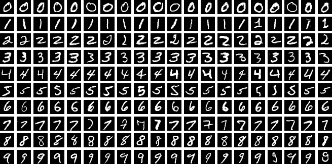
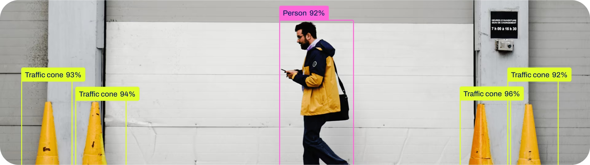
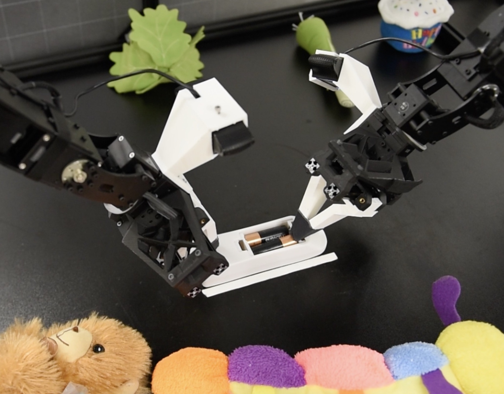

# 第一个 AI 项目：从基线到可复现结果

第一个项目可以从一个能解释、能比较、能重复运行的小实验开始。先选一个便于检查数据和分析错误的任务，再决定是否需要神经网络。下面的入门路线不要求 API 密钥、云模型、GPU 或机器人硬件；下载公开依赖或数据后，可以在本地完成核心部分。根据设备与时间条件确定规模，以能独立解释和复现的结果为阶段目标。

## 学习目标与基本流程

完成一个项目后，应能说明：任务与数据是什么，基线为何合理，训练改变了什么，评估是否独立，失败集中在哪里，以及别人怎样复现。缺少相关基础时，可参照[基础知识](basics.md)补充学习；更系统的安排见[学习路径](learning-path.md)、[课程与教材](courses.md)和[实践训练](practice.md)。

1. **数据：** 定义输入、目标、观测单位、来源/许可与划分；抽查标签、重复和缺失。先划分，再拟合预处理。
2. **基线：** 运行常数、关键词或简单线性模型，先确认指标计算正确。
3. **训练：** 固定一套配置，保存参数、随机种子、数据版本和训练日志；一次只改变一个主要因素。
4. **评估：** 用验证集选择方案，确定评估协议后，再在测试集上评估。相关个体按组划分，时间任务按时间划分。
5. **错误分析：** 保留成功和失败案例，按类别、长度、场景或来源分组分析；不要只展示最好的一张图。
6. **复现：** 在新目录中重新运行，提交代码、依赖版本、配置、指标表和简短报告。结果不同，记录差异及可能原因。

这里的项目是 **指南建议的可选学习路线** 。选择一项即可，后面的例子是替代方案，不是必须逐项完成的顺序。先用内置或小型数据集和简单模型进行一次短运行，测量资源消耗，再按实际内存、存储、时间和访问条件确定规模。下文样本量用于说明可管理的学习任务，既不是硬件保证，也不是研究所需样本量的计算结论。动手前，可以先阅读官方示例，理解其中各项选择的依据，再实现自己的版本。

| 等级 | 路线 | 最小成果 |
| --- | --- | --- |
| A：会基本 Python | [数字分类](#project-mnist)、[表格回归](#project-tabular) | 固定划分、基线、指标和错误分析 |
| B：会 ML 评估 | [资料检索](#project-retrieval)、[工具 Agent](#project-agent) | 标注查询/任务集、对照结果、可追踪输出 |
| C：会训练循环 | [字符语言模型](#project-language-model)、[视觉检测](#project-yolo) | 小规模训练或本地推理、成本记录和消融 |
| D：方向探索 | [机器人数据](#project-robotics) | 数据检查、时间序列基线与任务边界 |

## A1. 数字分类：先在 CPU 上完成完整实验

**任务与数据。** 输入手写数字图片，预测 0–9 类。先用 scikit-learn 自带的 [digits](https://scikit-learn.org/stable/modules/generated/sklearn.datasets.load_digits.html)：1,797 张 8×8 图片， **不是 MNIST 的 28×28 图片** 。官方[数字分类示例](https://scikit-learn.org/stable/auto_examples/classification/plot_digits_classification.html)展示加载、展平、训练与混淆矩阵。

- **前置与基线：** 会数组和训练/验证/测试划分。先用多数类预测，再用标准化加逻辑回归；只在训练数据拟合标准化。
- **训练与对照：** 固定分层划分，比较逻辑回归与 SVM 或小 MLP；如需调参，应使用验证集，不把官方示例的测试集反复当验证集。
- **指标：** accuracy、macro-F1、各类样本数与混淆矩阵；展示几组错误，区分难例和标签/预处理问题。在这个数据集中随机留出图片进行评估，不能证明模型能够泛化到未见过的书写者或新的采集条件。
- **资源：** digits 可在普通 CPU 上起步，不需要外部服务。MLP 的宽度、轮数和搜索次数应设上限，记录真实运行时间。
- **交付物：** 划分索引、可运行脚本、预测 CSV、指标表、至少十个错误例子；不足十个时报告全部。解释更复杂模型是否带来足够收益。

扩展时使用 [torchvision MNIST](https://docs.pytorch.org/vision/stable/generated/torchvision.datasets.MNIST.html)，先取固定训练子集，再比较同一划分上的 MLP 与小 CNN。官方测试集留到方案确定后使用。下图展示 MNIST，与第一条路线中的内置 digits 数据不同。

<figure class="resource-figure wide"><figcaption><a href="https://en.wikipedia.org/wiki/MNIST_database" target="_blank" rel="noopener">MNIST 手写数字</a> · <a href="https://www.kaggle.com/competitions/digit-recognizer/overview" target="_blank" rel="noopener">Kaggle</a></figcaption></figure>

[Kaggle Digit Recognizer](https://www.kaggle.com/competitions/digit-recognizer/overview)及其 [Data](https://www.kaggle.com/competitions/digit-recognizer/data)、[Code](https://www.kaggle.com/competitions/digit-recognizer/code) 页面可作为可选比赛入口，访问/运行条件以平台为准。提交排行榜不是完成本项目的要求，也不替代本地验证。理解网络可配合 [3Blue1Brown](https://www.3blue1brown.com/lessons/neural-networks/)；训练循环可参考 [PyTorch Basics](https://docs.pytorch.org/tutorials/beginner/basics/intro.html)，其示例使用 FashionMNIST，注意不要混淆数据集。

## A2. 表格回归：先处理好数据，再考虑更复杂的模型

**任务与数据。** 用 [scikit-learn diabetes](https://scikit-learn.org/stable/modules/generated/sklearn.datasets.load_diabetes.html) 的 442 个样本、10 个特征预测其文档定义的连续目标。本练习使用 `load_diabetes(scaled=False)`，再在训练折内拟合预处理。这是统计教学数据，项目结论限于该数据和评估协议，不能作为医疗预测工具。

- **前置与基线：** 会均值、方差和回归。用训练集目标均值作 `DummyRegressor` 基线，再用包含训练折标准化的岭回归 Pipeline。
- **训练与对照：** 固定外层留出测试集，在其余数据上做交叉验证选择正则化；可比较一棵限深树。使用同一折与相同调参预算，不根据小测试集上的表现选择最优模型。
- **指标：** MAE、RMSE、残差图与测试样本数；报告各折波动。RMSE 更强调大误差，R² 可能为负。内置数据默认已做特定缩放，因此本练习显式使用 `scaled=False`，缩放方式也应写进报告。
- **资源：** CPU，数百行数据，无模型权重或云训练需求；限制树深和候选超参数数量。
- **交付物：** 字段说明、划分、模型配置、交叉验证与测试指标、残差分析。在新目录核对 Pipeline 的缩放仅在训练折拟合，测试集只使用已拟合的变换。

## B1. 资料检索：先评估 RAG 的检索部分

**任务与数据。** 从 30–100 段自己写的课程笔记中，为查询返回相关段落与来源。手工制作约 40 条查询及相关段落 ID，将近重复问法分组后划分开发/测试查询。固定文档库作为可检索语料；测试查询的相关性标注不能用于调参。

- **前置与基线：** 会字符串、集合和评价指标。先按关键词重叠排序，再用 [scikit-learn TF-IDF](https://scikit-learn.org/stable/modules/feature_extraction.html#text-feature-extraction) 与余弦相似度。中文可明确选字符 n-gram，避免默认英文分词不适用的问题。
- **训练与对照：** 在固定文档库上拟合 TF-IDF；为部署时可见的文档建索引，与利用留出相关性标签调参不同。在开发查询上比较分段长度或词/字符特征，随后锁定测试配置。改变分段后，应按统一规则将相关性标注映射到新片段，再比较结果。不需要训练生成模型。
- **指标：** Recall@k（找回的相关段落数/全部已标注相关段落数）、MRR（首个相关结果排名倒数的均值）、查询延迟；注明 k、无相关答案查询的处理和标注覆盖范围。
- **资源：** CPU，小文档库和稀疏矩阵；先限制全文总量与特征数。无需向量数据库、API 密钥或下载大型嵌入模型。
- **交付物：** 文档清单、标注与划分、每条查询的排名/分数/来源、指标与失败归因。分别标注分段错误、词汇不匹配、相关性歧义和确实无答案。

返回原文片段和引用就能完成这个 **检索项目** ，它还不是完整的生成式 RAG。进阶时可接入适合本机资源的本地生成模型，分别评估检索召回、答案正确性和引用支持度；不将答案流畅视为检索有效的证据。无关文档中的指令不应变成工具权限或执行指令。

## B2. 工具 Agent：先保证动作与反馈可检查

**任务与数据。** 搭建一个只操作本地测试数据的工具调用循环：读取问题，选择计算器或笔记检索，检查工具返回值，再作答或停止。编写约 50 个任务，覆盖正常输入、无答案、错误参数和超出能力范围，按模板分组划分开发/测试任务。

- **前置与基线：** 会函数、异常、JSON 和简单状态机。先做单步规则路由作为基线；循环策略加入失败处理、最多三次工具调用与明确停止状态。
- **训练与对照：** 起步时使用规则策略，不需要语言模型。比较单步/多步与有/无参数校验；若训练本地意图分类器，仅使用开发任务中的训练数据，保留测试模板。它是工具控制的入门环境，不能据此声称复现了 LLM Agent 的推理能力。
- **指标：** 依据预先写好的答案和容差判定的任务成功率、无效调用率、平均调用次数、超预算率；失败同样进入分母。
- **资源：** Python 标准库与本地检索即可在 CPU 上完成；禁用任意 shell 和网络。计算器只接受白名单算术操作，限制表达式长度、数字规模与步数，不能直接对输入使用 `eval`；[Python AST 文档](https://docs.python.org/3/library/ast.html)解释语法树，但解析本身不构成安全沙箱。
- **交付物：** 工具输入/输出模式、任务划分与判分程序，以及包含任务、动作、参数、返回值和停止原因的完整轨迹。固定外部状态，使每次重新运行的结果可比较。

[Hugging Face Agents Course](https://huggingface.co/learn/agents-course/en/unit0/introduction)和 [Hello Agents](https://github.com/datawhalechina/hello-agents)可帮助理解模型驱动的工具调用；选择示例前核对模型、依赖、账号和计算要求。它们是后续材料，本页的基础路径不依赖在线模型。

<figure class="resource-figure medium"><figcaption><a href="https://huggingface.co/learn/agents-course/en/unit0/introduction" target="_blank" rel="noopener">Hugging Face Agents Course</a></figcaption></figure>

[ReAct 原项目](https://react-lm.github.io/)展示语言模型交替生成推理与动作、接收环境反馈的方式。比较时区分你实现的规则基线和模型策略；进一步问题见 [Agent 方向](agent.md)。

## C1. 字符语言模型：从计数到一个小网络

**任务与数据。** 生成与训练词表具有相似字符统计特征的新字符串。参考作者的 [Zero to Hero](https://karpathy.ai/zero-to-hero.html) 和 [makemore 说明](https://raw.githubusercontent.com/karpathy/makemore/master/README.md)。可以使用其示例名字数据并保留来源，也可以用自写的短词列表；先按完整条目去重、划分，再生成上下文窗口。

- **前置与基线：** 会条件概率、交叉熵和训练循环。用带平滑的字符 bigram 计数模型作基线，确认起止符、词表和未知字符策略。
- **训练与对照：** 实现短上下文 MLP，先用小子集和小隐藏层；固定数据、词表、评估窗口与更新预算，再比较上下文长度或网络宽度。Transformer 是可选延伸。
- **指标：** 独立测试集的平均每字符负对数似然，以及同一分词和边界约定下的 perplexity；记录生成样本与训练条目重复率。不同 tokenizer 或数据处理下的 perplexity 不直接可比。
- **资源：** CPU 起步；例如最多几万字符、短上下文和约十万量级以下的参数，先测量一个 batch 的内存占用和运行速度，再确定训练步数。这是建议规模，运行时间要实测。
- **交付物：** 数据来源/划分、训练曲线、基线与网络指标、固定种子样本、参数量与耗时。说明“字符串看起来像名字”与“模型具备语言理解”是不同结论。

## C2. 视觉检测：先测本地推理，再决定是否训练

**任务与数据。** 在自己有使用权的照片中定位模型支持类别的物体。选择官方支持的一个小型预训练检测器，按 [Ultralytics Quickstart](https://docs.ultralytics.com/quickstart) 在本地 CPU 运行，记录具体模型文件与软件版本；为方便日后复现，不要只记录文档中的“最新”模型名称。

<figure class="resource-figure wide"><figcaption><a href="https://docs.ultralytics.com/tasks/detect/" target="_blank" rel="noopener">Ultralytics · 目标检测</a></figcaption></figure>

- **前置与基线：** 会分类/检测区别与 IoU。固定一个预训练模型与配置为基线，制作一个包含边界框标注的小型独立评估集，并说明它是否可能与预训练数据重合。
- **训练与对照：** 先不训练，比较不同置信度阈值或输入分辨率的影响；用开发图片选择设置，测试图片只做最终评估。没有自定义训练时，明确标为推理实验；有资源后才考虑微调，并保留训练/验证/测试划分。
- **指标：** 按[官方验证文档](https://docs.ultralytics.com/modes/val)记录 precision、recall、mAP50、mAP50–95 与单图延迟；说明类别、IoU、样本量和硬件。置信度阈值处的 precision/recall 与跨阈值汇总的 AP 含义不同。
- **资源：** 小模型、少量静态图可先尝试 CPU，模型权重需要下载空间；批量视频和训练应另做时间/内存预算，不保证实时性或免费 GPU。
- **交付物：** 标注/许可与划分、预测框、指标与计时方法，以及按遮挡、小物体、漏检和误检等情况分组的结果。只有可视化截图时，不把它当作定量性能证据。

[COCO8](https://docs.ultralytics.com/datasets/detect/coco8)只有八张图片，适合按[训练教程](https://docs.ultralytics.com/modes/train)检查数据格式、训练/验证流程；它不足以支撑可靠的模型性能比较。[Colab 教程入口](https://docs.ultralytics.com/integrations/google-colab)保留作可选运行方式，配额和硬件以平台实际可用情况为准。更多方法见[计算机视觉](vision.md)。

## D. 机器人：先理解演示数据，无需从购买硬件开始

[ACT / ALOHA](https://tonyzhaozh.github.io/aloha/)的项目视频展示从人类演示学习操作；[LeRobot 文档](https://huggingface.co/docs/lerobot/index)与[代码](https://github.com/huggingface/lerobot)提供机器人数据和学习工具。

<figure class="resource-figure robot"><figcaption><a href="https://tonyzhaozh.github.io/aloha/" target="_blank" rel="noopener">ACT / ALOHA</a></figcaption></figure>

- **任务与数据：** 从一个公开示范数据集中选少量完整 episode，核对图像、状态、动作、时间戳、单位、坐标系和控制频率，保留数据来源、许可与版本。
- **前置与基线：** 会时间序列和回归。先把动作曲线可视化；在适用的连续动作任务上，以“下一步等于上一步动作”作一步预测基线。
- **训练与对照：** 按完整 episode 分割，用小线性模型预测下一步动作。先定义目标是当前还是后续动作，以及选择该动作时能观察到什么，再据此对齐时间戳。比较单帧状态与短历史，不把同一轨迹相邻帧随机分到不同划分。
- **指标：** 按动作维度和单位报告 MAE，并和基线比较；这衡量离线预测误差， **不能替代闭环任务成功率或安全性评估** 。
- **资源与交付物：** 在 CPU 上读取少量数据并拟合小回归器，注意视频/图像解码与下载空间；交付字段表、episode 划分、曲线、误差和限制说明。仿真策略训练、真实控制与硬件实验需要另行规划资源，见[具身智能](embodied.md)。

## 失败时如何缩小问题

| 现象 | 排查顺序 |
| --- | --- |
| 依赖安装或数据下载失败 | 保留完整错误，检查官方版本要求与路径；先用内置数据，不直接更换一整套框架 |
| 训练 loss 不下降或出现 NaN | 检查标签、数值范围、输出/损失匹配与梯度；尝试拟合一小批数据后再扩展 |
| 验证分数异常高 | 检查重复、目标泄漏、预处理是否接触测试集，以及按人/时间/文档划分是否合理 |
| 新场景表现差 | 检查数据覆盖与分布变化；按失败类型采样，先修正数据或评估协议，再决定是否修改模型 |
| CPU 太慢或内存不足 | 记录瓶颈，减少样本量、降低分辨率、缩短上下文，并限制搜索预算；保留可比较的基线，按需要另行规划资源 |
| Agent 不停循环或引用失真 | 设置调用预算与停止条件，保留失败轨迹；核对来源片段与答案是否对应 |

## 完成后的复现包

一份基本的复现包应包含 README、运行入口、固定的依赖与配置、数据获取与划分说明、原始预测和指标，以及一至两页报告。报告写清 **问题、方法、对照、结果、不确定性、失败和结论边界** 。有随机训练且预算允许时用多个种子重复，报告各次结果与汇总；先完成一次可靠的小实验，再扩大规模。研究级比较还需考虑统计单位、置信区间与调参预算，见[研究方法](research-methods.md)。

编程助手可以帮助解释或检查实现，下面是可选的工具入口；普通编辑器与本地 Python 已足够。接受生成代码前，应能解释数据流，并用若干答案已知的输入核对。自动生成的报告与分数仍需独立验证。

<a class="logo-entry" href="https://www.trae.cn/" target="_blank" rel="noopener">TRAE</a><a class="logo-entry" href="https://www.workbuddy.cn/" target="_blank" rel="noopener">WorkBuddy</a><a class="logo-entry" href="https://claude.com/product/claude-code" target="_blank" rel="noopener">Claude Code</a><a class="logo-entry" href="https://zcode.z.ai/" target="_blank" rel="noopener">ZCode</a><a class="logo-entry" href="https://openai.com/codex/" target="_blank" rel="noopener">Codex</a>

[AI 工具](ai.md) · [基础知识](basics.md) · [学习路径](learning-path.md) · [课程与教材](courses.md) · [实践训练](practice.md) · [研究方法](research-methods.md) · [研究方向](directions.md) · [找资料和读论文](reading.md)
